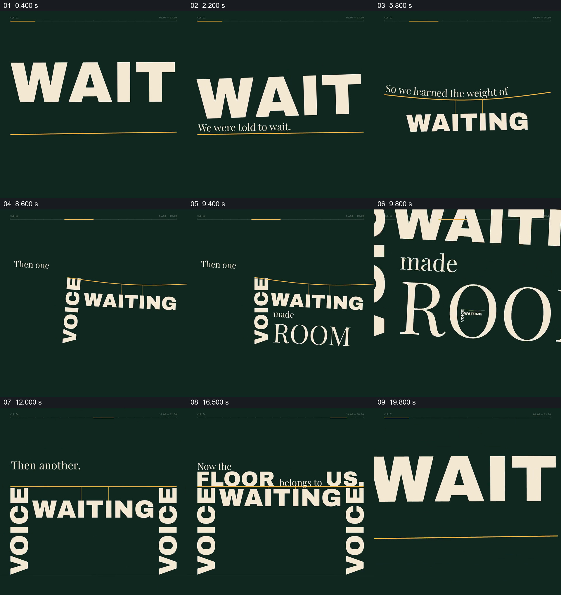

# 让“等待”悬在线下，再用两个声音撑出空间

- 作品：案例 118。
- 原片范围：00:00.000–00:20.000（源时间，含起点、不含终点）；[完整原片](../video.mp4)｜[本卡片段](../video.mp4)。复用完整原片和同范围分镜。
- 观察方式与未确认范围：核看全片 64 帧总览和本卡九宫格；原片无音轨；未独立连续原速观看，抽帧间运动和精确节奏未确认。价值判断为作品分析，跨项目迁移尚未实测。

## 原画面具体怎样设计

深绿色方形画面上，大号浅色“WAIT”压在中央，下方一条黄线横贯画面；小字逐渐补成“We were told to wait.”。随后大字让位，句子变为“So we learned the weight of”，粗体“WAITING”出现在黄线下方。细短竖线将字和黄线连接，线的中央下弯；词语既可以阅读，也像悬挂的重量。

“Then one”出现后，“VOICE”先位于左侧，再以竖向靠在黄线左端；WAITING 仍留在线下。“made ROOM”出现，ROOM 放大后，其 O 形开口内仍可看见先前的小结构，下一组画面又回到原先的线和文字。

“Then another.”引出右侧第二个竖向 VOICE，两侧词语像支柱，黄色横线在源帧中从弯曲趋于接近平直，WAITING 仍在中间。上方逐渐补出“Now the FLOOR belongs to US.”，文字和线形成有两侧支撑的空间；片尾字形放大、经过浅色遮盖，又出现接近开头的 WAIT 与黄线。

## 为什么这样设计，好在哪里

等待没有被另画成抽象重物，而是让文字本身挂在线上；两次 VOICE 的位置变化分别改变这条线的支撑关系，观众能同时阅读句子和看见它的空间比喻。ROOM 放大时保留旧结构作为内部参照，再回到悬挂构图，避免将“空间”仅写成一个形容词。

支撑与重量是视觉隐喻的分析，不是对现实因果的证明；原片无音轨，无法推断音乐或语气。

## 可直接使用的创意指令

当文案的关键词之间本来就有负担、支撑或空间关系时，先挑一个可读的关键词作为主物件，再用线、留白或文字位置让其与另一个词发生明确关系。让第一个参与者改变结构的一端，保留原有“负担”；再逐步加入新的参与者，使整体形成可辨的结果。文字应先能读懂，再承担造型任务。

可用其他词语、线条、字体和画幅；核心是同一结构持续可追踪，新增词语确实改变原有关系。需要长句阅读或不适合用物理隐喻的内容，应减少变化或选择其他表达。
