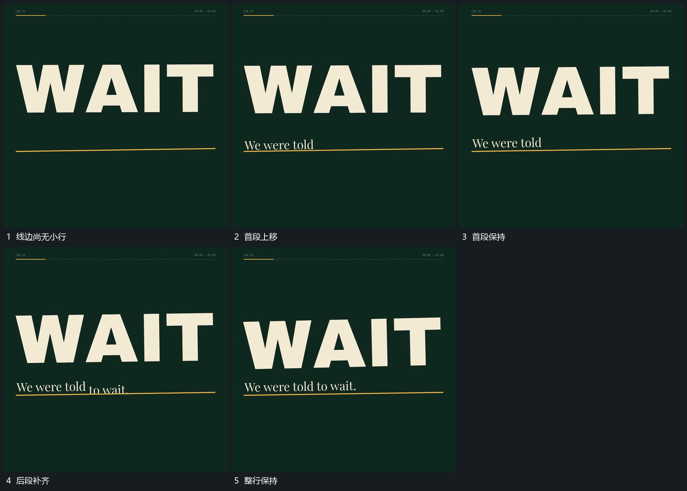

# 新行从横线边逐段上移旧行沿同一边界退去

## 运动指令

保持横线位置，先让首段小行由线下向上经过边界，再错开补入后段。已出现的段保持，后段继续到位；需要换行时，旧行沿同一边界退去，新行再上移接管，不使横线重新入场。

## 视频切片

[播放本机制的原片切片](m01.mp4)

覆盖分镜中“线边尚无小行”至“整行保持”的连续过程，并保留邻近的前后衔接画面；原片中交叠发生的动作一并保留。

## 分镜过程

## 组合与调整

可在整片多处复用，不继承原句；只有新信息出现时才推动新段，静止阅读不另拆机制。
