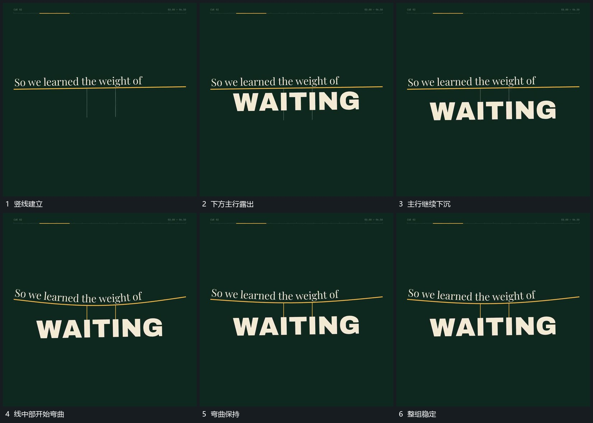

# 下方主行挂在线下下沉使横线中部弯曲

## 运动指令

保留横线两端，向下伸出细竖线，让主行从横线下方逐步露出并下沉。竖线持续连接主行与横线，中部随下沉逐渐弯曲；停止后保持悬挂间距，不把线和主行当成两套无关运动。

## 视频切片

[播放本机制的原片切片](m03.mp4)

覆盖分镜中“竖线建立”至“整组稳定”的连续过程，并保留邻近的前后衔接画面；原片中交叠发生的动作一并保留。

## 分镜过程

## 组合与调整

可改为图片或框；这里只迁移承托、下沉与弯曲关系，不推定真实重量或物理模拟。
