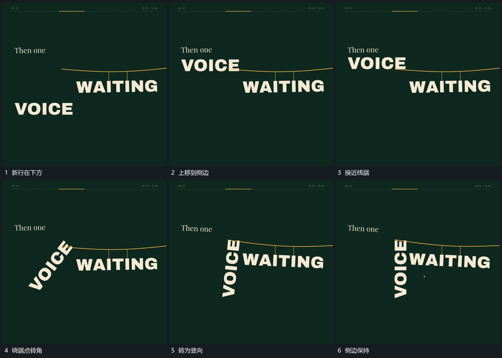

# 侧行上移到线端固定一端转成竖向

## 运动指令

让新行从下方上移到横线侧端，靠线的一端先到位并保持。整行绕这个接点转角，自由端向下经过，最终成为竖向侧行；横线与原线下主行保持连接。

## 视频切片

[播放本机制的原片切片](m04.mp4)

覆盖分镜中“新行在下方”至“侧边保持”的连续过程，并保留邻近的前后衔接画面；原片中交叠发生的动作一并保留。

## 分镜过程

## 组合与调整

新行可换成细长片；转角中心在接点，不让整行先绕自身中心旋转再突然移到线旁。
