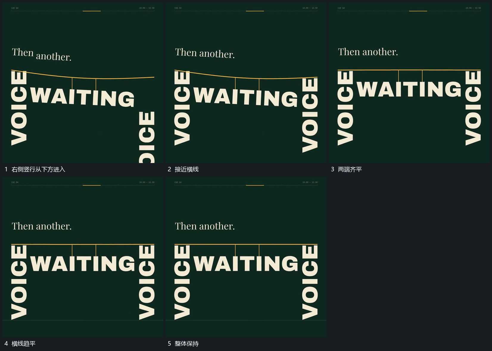

# 另一侧竖行从下方上移接线使两端齐平

## 运动指令

保留左侧竖行与线下主行，另一侧竖行由下方上移，顶端逐渐接近横线末端。接点建立后两端趋于齐平，横线中部减少弯曲，原有主行仍挂在同一位置关系中。

## 视频切片

[播放本机制的原片切片](m06.mp4)

覆盖分镜中“右侧竖行从下方进入”至“整体保持”的连续过程，并保留邻近的前后衔接画面；原片中交叠发生的动作一并保留。

## 分镜过程

## 组合与调整

两侧不必完全对称；新行进入时旧接点持续存在，不能为了对齐先清空原排列。
