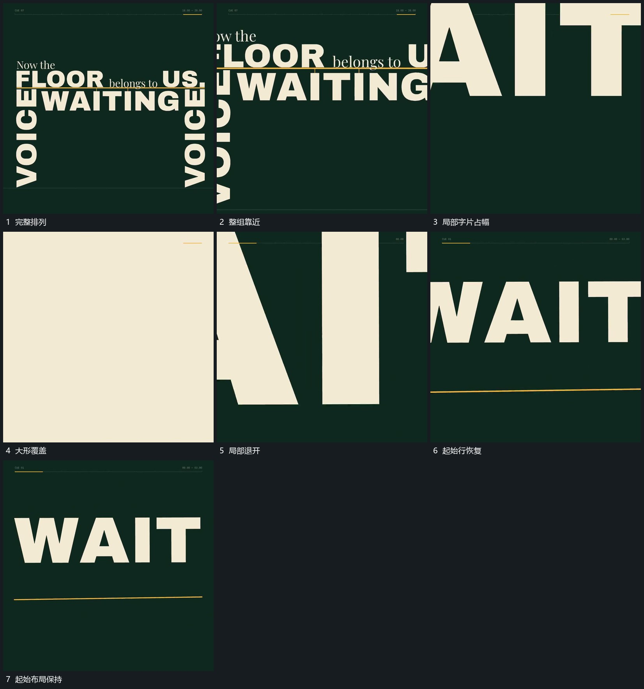

# 整组放大越界再从局部回退建立循环接点

## 运动指令

让完整排列整体放大并向主行局部靠近，外围和两侧先越界，局部大形覆盖可见范围。随后从大形局部回退并整理为起始大行和横线，前后保持相近的基线与占幅，便于接回开头。

## 视频切片

[播放本机制的原片切片](m07.mp4)

覆盖分镜中“完整排列”至“起始布局保持”的连续过程，并保留邻近的前后衔接画面；原片中交叠发生的动作一并保留。

## 分镜过程

## 组合与调整

覆盖后的布局回退按新片重新实现；不推定原作者用了真实镜头或隐藏三维结构，循环接点仍需新片预览核验。
