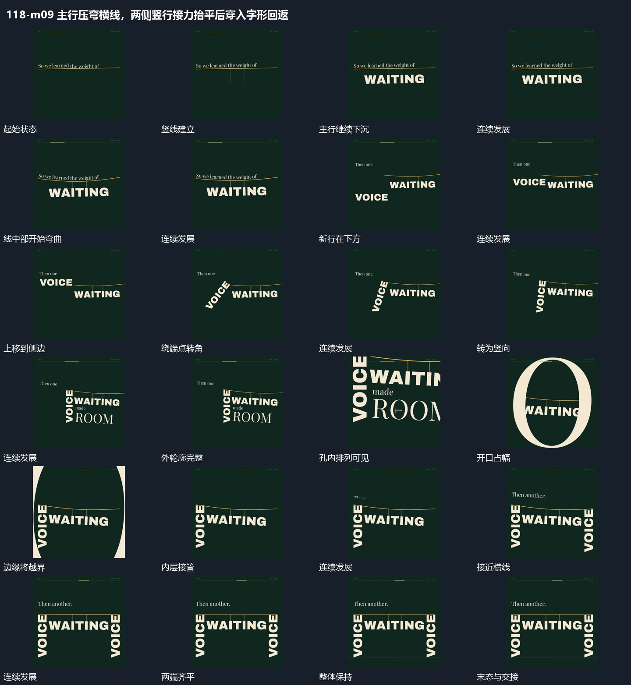

# 主行压弯横线，两侧竖行接力抬平后穿入字形回返

## 运动指令

起始：横线及两条竖向细线已在。

1. 主行挂在线下逐渐下沉使横线弯曲。

2. 一侧短行上移到线端并转成竖向支撑，新增字形的开口放大引导取景穿入再回到整体。

3. 另一侧竖行从下方上移接线，使两端重新齐平。

上述镜头变化与局部动作按同一条连续过程推进；写明同时发生的步骤在原场面中交叠，不先完成整段运镜再重演局部。

## 视频切片

[播放本机制的原片切片](m09.mp4)

保留起始准备、连续发展和完成或明确交接；首尾按本段运动范围裁切，不拼接、不变速。相连的小动作合为同一完整段落。

## 分镜过程

## 组合与调整

保留以下动作关系：主行挂在线下逐渐下沉使横线弯曲；一侧短行上移到线端并转成竖向支撑，新增字形的开口放大引导取景穿入再回到整体；另一侧竖行从下方上移接线，使两端重新齐平。

可调整位移距离、层级间距、重复数量与相对快慢；已有锚点和未退出的层继续承接。连接下一段时以切片末态为起点，另行设计不连续的状态转换。
