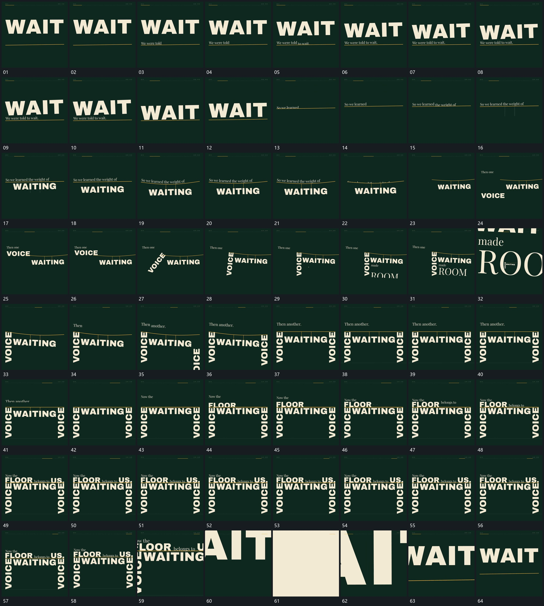

# 118｜原片运动总览

[观看完整原片](video.mp4)

## 运动总览

全片以一条横线持续充当共同参照。新行从横线边逐段上移旧行沿同一边界退去在横线上逐段引入小行，中央大行随后以大行落到横线回弹后向上退出落到线边、回弹并退出。新的小行复用新行从横线边逐段上移旧行沿同一边界退去接入，下方大行改用下方主行挂在线下下沉使横线中部弯曲挂在线下，让线形随它下沉而弯曲。

左侧新行上移到线边后，侧行上移到线端固定一端转成竖向固定它靠线的一端，将横行转为竖行。下方补出带开口的大轮廓，带开口轮廓放大取景穿入预先存在的内层让取景靠近开口中预先存在的同一排列，穿过开口后旧外框越界。右侧再以另一侧竖行从下方上移接线使两端齐平上移接到线端，两侧竖行共同承托横线，线逐步变直。

上方几组新行复用新行从横线边逐段上移旧行沿同一边界退去从线边接入，在线上累计成为完整排列，原有线下与两侧部分保持。末段整组放大越界再从局部回退建立循环接点把整组放大至局部越界，再从覆盖的大形回退到开头的大行与横线，形成循环接点。保持段不另拆卡。

## 完整运动段落

以下按原片中的出现顺序引用。建立、内部发展及完成反馈放在同一段中；同时发生的局部动作与运镜写在同一份指令里。不同段之间可以是连续接管，也可以是直接切换，不能仅凭条目相邻认定可直接拼接。重复出现的同类运动采用一次连续代表范围，切片不以逐段无缝覆盖整片为目标。

1. [主行与下方短行建立，主行落到横线回弹后向上退出](mechanisms/m08.md)：下方短行沿横线逐段建立，旧短行沿边界退出；主行随后下落接触横线、回弹，再向上退去，留下横线继续承接。

2. [主行压弯横线，两侧竖行接力抬平后穿入字形回返](mechanisms/m09.md)：主行挂在线下逐渐下沉使横线弯曲；一侧短行上移到线端并转成竖向支撑，新增字形的开口放大引导取景穿入再回到整体；另一侧竖行从下方上移接线，使两端重新齐平。

3. [整组放大越界再从局部回退建立循环接点](mechanisms/m07.md)：整体放大局部覆盖后回退

切片保留起始准备、必要内部停顿和完成或明确交接；首尾省略无新发展的等待，持续运动不要求人为停住。以上基于真实源帧序列和重点边界核对，不等同于全片连续声画审片。

## 完整64宫格

