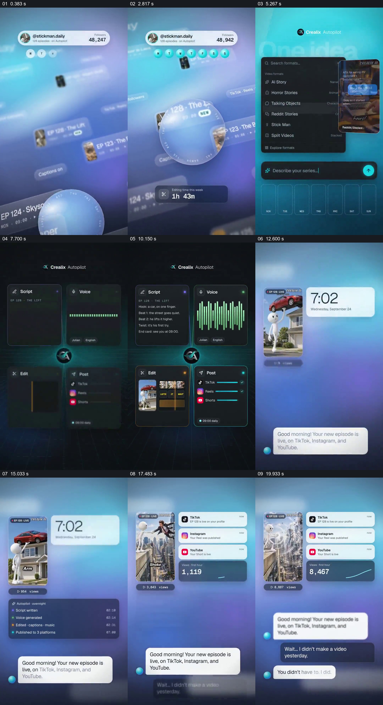

# 把一个系列样例送进四个制作面板，再用次日通知接回成片

- 作品：案例 042《手机画面与浮层提示》（库内索引名）。
- 原片范围：00:00.000–00:22.000，含起点、不含终点；[完整原片](../video.mp4)｜[本卡片段](c01.mp4)，片段起点对应原片 0.000 秒。
- 范围依据：0–22 秒从系列设定到四环节和次日结果共同完成一条样例流程；之后继续复述配置、增长与品牌收尾，不另拆独立卡。
- 观察方式：核看全片 64 帧总览及本卡九宫格；未独立连续原速观看，快速变化和运动节奏待核。未独立听审，声音内容未知。片中事实和演示未独立查证，新题材迁移尚未实测。

## 原画面具体怎样设计

竖画幅一开始是蓝紫色空间中斜置的系列条目，顶部悬浮账号、粉丝数和一周标记；半透明球体位于前景，底部 “Editing time this week” 的数字从较长时间变化到 0。随后画面转成亮青色设置界面：左侧是视频类型列表，右侧的竖视频样例随类型替换，下方输入一句系列描述，底部一周空槽逐渐有封面。

接下来深色界面以中央品牌节点为中心，四个面板分别写着 Script、Voice、Edit、Post。上方脚本文字和声音波形、下方剪辑画面与不同平台发布状态各自显露；样例中举车的小人物继续出现在剪辑小图里。画面随后扩成密集的内容缩略图墙，再把一个竖视频带入明亮的次日布局。

新布局左边保留正在展示的小人物视频及其观看数，右边先有 7:02 时间卡，再叠出 TikTok、Instagram、YouTube 的发布通知与观看趋势；下方对话先报新一集上线，随后回应“我昨天没做视频”“你不必做，是我做的”。这是片中的自动化叙事和界面演示，不能据此认定真实发生生成、发布或获得这些观看数字。

## 为什么这样设计，好在哪里

这种组织没有把“自动完成”只写成一个结果：相同系列样例先被选中，再进入四种具体工作状态，最后以视频、平台通知、观看数和对话重新出现。虽然界面从列表变成四区，又从缩略图墙换到次日屏幕，那个小人物样例提供持续参照，观众可以把多组画面读作一个内容的经历。四个并列面板把不同工作放在同一时空里，次日时间和对话将抽象流程转成可想象的使用场景。

如果前后换成无法辨认关系的素材，多面板就容易变成互不相干的功能清单；如果只有完成通知、没有前面可见的输入与各环节，也很难理解它宣称完成了什么。此处是根据画面作的解释，并未验证产品功能、实际节省时长或观众感受。

## 可直接使用的创意指令

需要介绍一条跨多个步骤的工作流时，先选定一个可以从头到尾辨认的具体任务：展示原始设定、一个代表样例和明确输入；把关键工作环节放在可区分但同属一组的区域，让每个区域有能读懂的真实状态或作品局部。进入结果场景时保留同一任务的画面或标识，再用实际时间、完成记录、通知或可核验结果展示发生了什么。流程有审核、排队或失败时按真实情况保留，不把宣传界面当成完成证明；平台、面板数量、示例题材、颜色与对话形式按新内容调整，不能把未经核实的数据或发布状态写成事实。
