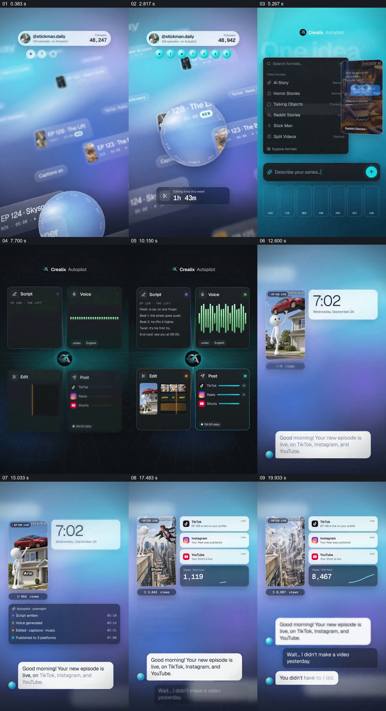

# 把一个系列样例送进四个制作面板，再用次日通知接回成片

- 作品：案例 042《手机画面与浮层提示》（库内索引名）。
- 原片范围：00:00.000–00:22.000，含起点、不含终点；[完整原片](../video.mp4)｜[本卡片段](c01.mp4)，片段起点对应原片 0.000 秒。
- 范围依据：0–22 秒从系列设定到四环节和次日结果共同完成一条样例流程；之后继续复述配置、增长与品牌收尾，不另拆独立卡。
- 观察方式：核看全片 64 帧总览及本卡九宫格；未独立连续原速观看，快速变化和运动节奏待核。未独立听审，声音内容未知。片中事实和演示未独立查证，新题材迁移尚未实测。

## 原画面具体怎样设计

竖画幅一开始是蓝紫色空间中斜置的系列条目，顶部悬浮账号、粉丝数和一周标记；半透明球体位于前景，底部 “Editing time this week” 的数字从较长时间变化到 0。随后画面转成亮青色设置界面：左侧是视频类型列表，右侧的竖视频样例随类型替换，下方输入一句系列描述，底部一周空槽逐渐有封面。

接下来深色界面以中央品牌节点为中心，四个面板分别写着 Script、Voice、Edit、Post。上方脚本文字和声音波形、下方剪辑画面与不同平台发布状态各自显露；样例中举车的小人物继续出现在剪辑小图里。画面随后扩成密集的内容缩略图墙，再把一个竖视频带入明亮的次日布局。

新布局左边保留正在展示的小人物视频及其观看数，右边先有 7:02 时间卡，再叠出 TikTok、Instagram、YouTube 的发布通知与观看趋势；下方对话先报新一集上线，随后回应“我昨天没做视频”“你不必做，是我做的”。这是片中的自动化叙事和界面演示，不能据此认定真实发生生成、发布或获得这些观看数字。

## 为什么这样设计，好在哪里

这种组织没有把“自动完成”只写成一个结果：相同系列样例先被选中，再进入四种具体工作状态，最后以视频、平台通知、观看数和对话重新出现。虽然界面从列表变成四区，又从缩略图墙换到次日屏幕，那个小人物样例提供持续参照，观众可以把多组画面读作一个内容的经历。四个并列面板把不同工作放在同一时空里，次日时间和对话将抽象流程转成可想象的使用场景。

如果前后换成无法辨认关系的素材，多面板就容易变成互不相干的功能清单；如果只有完成通知、没有前面可见的输入与各环节，也很难理解它宣称完成了什么。此处是根据画面作的解释，并未验证产品功能、实际节省时长或观众感受。

## 完整照排指令

以[完整原片](../video.mp4)的 0–22 秒为准。画幅 720×1280，源帧率 60/1。以下拍点为抽帧定位，位置按画幅百分比取近似值。

### 用料

【系列首画】【成片预览】【次日封面】【制作素材组】使用同一集的样例，主角及画面锚点在次日预览中可认。备【系列栏目】【输入短句】【脚本文字】【配音波形】【剪辑预览】【发布渠道组】【次日时刻】【通知文字】【统计读数】【统计曲线】。若是实际发布，保留相应平台回执和数据出处。

### 按源时刻摆放

1. **0–约 4 秒。** 竖幅青蓝至深紫渐变，浅透明球体在前后层移动。上缘压白色身份条及一排小圆符号。后方近黑斜视轨道承托【系列首画】及几张竖卡。暗计时条靠下把画面引向下一段，球体只作环境，允许平滑循环。
2. **约 4–7 秒。** 转亮青底，偏左黑色菜单竖框列【系列栏目】，右侧半重叠小竖窗依次显示候选，末态为本集【成片预览】的主要画面。底部横排暗输入栏【输入短句】，青色圆钮贴右端。
3. **约 7–11 秒。** 深青近黑，四块制作窗在中部以两列两行建立。左上【脚本文字】，右上【配音波形】，左下【剪辑预览】，右下【发布渠道组】。中间小圆标但不掩窗；从字、波形到成片逐步填充，旧窗保留至切出。动态预览用同一集连续段，避免给画面改署名或循环进度。其后用多排【制作素材组】铺满短暂停顿。
4. **约 11–20 秒。** 改青蓝紫晨间底，左侧竖【次日封面】，右上亮卡白底黑字【次日时刻】，中部暗清单及【通知文字】依次出现。之后右侧累积三条浅【发布渠道组】，同一集封面仍在左，下方暗块加入【统计读数】和上扬【统计曲线】。读数仅对应已说明的同集发布统计。底部对白卡保留原位并逐句增加，直到暗场离开。
5. **约 20–22 秒。** 回暗青制作界面，短见本集图排及横向波形，亮青页在尾界接管。按 22 秒切出。

### 局部采用

有同集制作记录可取约 4–11 秒；若只有可追溯的发布和统计，可取约 11–20 秒。

### 验证状态

已对照逐秒原片画序并读回，核对制作四窗同场、同集接到次日封面及渠道与读数累积。精确帧、原速听看和换料试摆待核。
