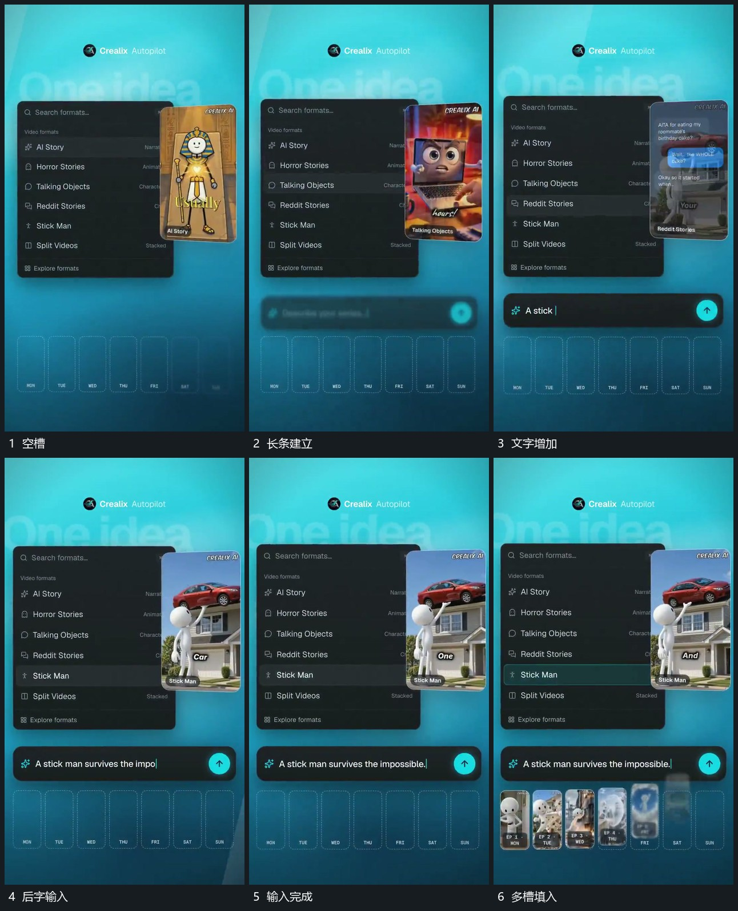

# 长条逐字输入完成，小图逐项填入下部空槽

## 运动指令

在下部预留一排空槽，先在其上建立长条并逐字输入。文字完成后把小图按顺序填入空槽，已有小图保持，未填槽继续显出空边界。

## 视频切片

[播放本机制的原片切片](m03.mp4)

覆盖分镜中“空槽”至“多槽填入”的连续过程，并保留邻近的前后衔接画面；原片中交叠发生的动作一并保留。

## 分镜过程

## 组合与调整

填槽不必一口气填满。保留输入结束到图组接上的顺序。
