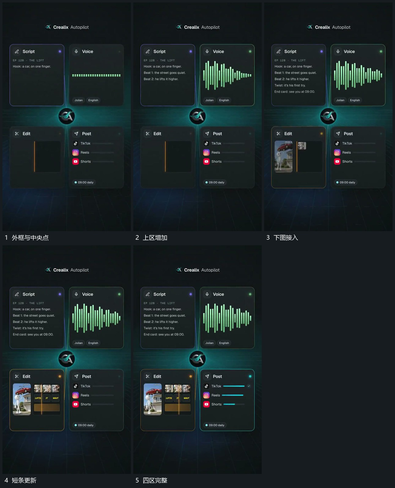

# 中央节点连接四区，各区内部错开补齐

## 运动指令

以中央节点把周围四个区块连接起来，先建立外框，再错开补入各区内部：一处文字逐行增加，一处短柱活动，另一处小图填槽，下区短条延长。先完成区保持，后区继续推进。

## 视频切片

[播放本机制的原片切片](m04.mp4)

覆盖分镜中“外框与中央点”至“四区完整”的连续过程，并保留邻近的前后衔接画面；原片中交叠发生的动作一并保留。

## 分镜过程

## 组合与调整

可减少区块，重点是共用节点与区内不同动作的接续，不用整组同时跳动。
