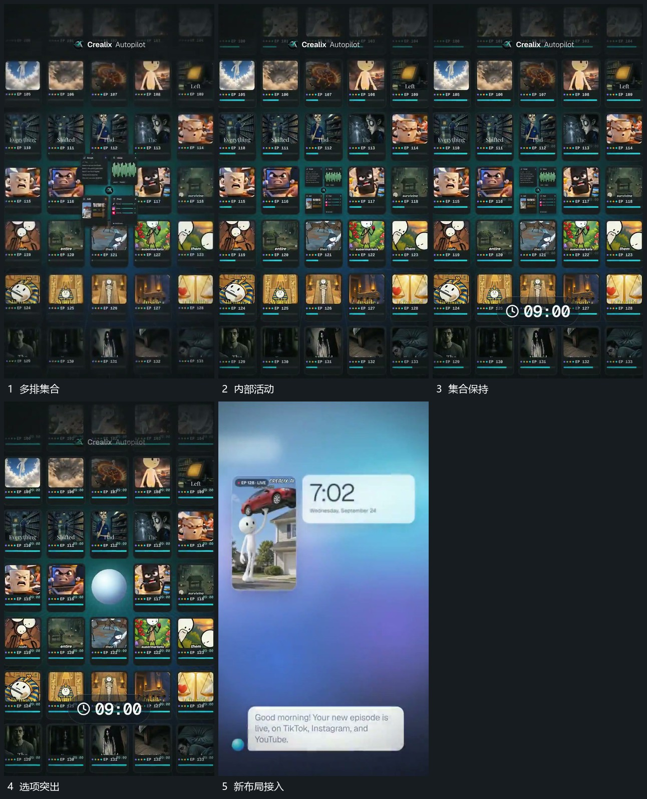

# 满幅格集合持续活动，保留一项接管新布局

## 运动指令

让多排小格铺满画面，各格内部继续活动。在集合中保留一项，周边格逐步退出，由该项接管新布局；新的旁侧大条与下部气泡随后接入，选项内部活动延续。

## 视频切片

[播放本机制的原片切片](m05.mp4)

覆盖分镜中“多排集合”至“新布局接入”的连续过程，并保留邻近的前后衔接画面；原片中交叠发生的动作一并保留。

## 分镜过程

## 组合与调整

选项须来自真实集合位置。只保留连续关系，不推定原片筛选逻辑。
