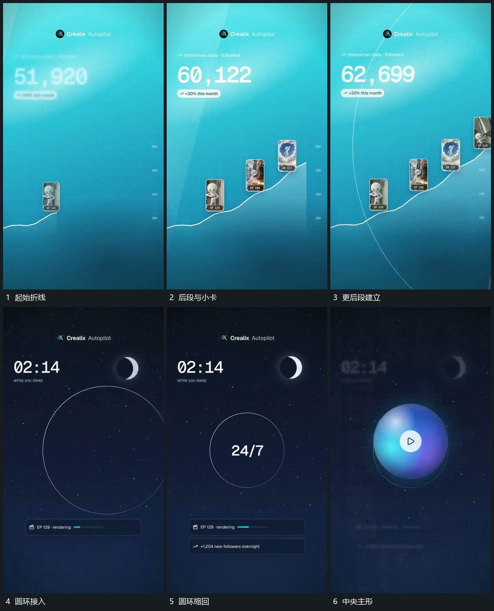

# 折线向后延长，沿线小卡逐项增加，圆环接手收尾

## 运动指令

让折线从起始段向后延长，小卡在已经到达的沿线空位逐项增加，旁侧数值继续变化。轨迹组完成后让圆环接入并缩回中央主形，由主形接续最后布局。

## 视频切片

[播放本机制的原片切片](m08.mp4)

覆盖分镜中“起始折线”至“中央主形”的连续过程，并保留邻近的前后衔接画面；原片中交叠发生的动作一并保留。

## 分镜过程

## 组合与调整

轨迹和圆环可以分开组合，但两段之间须有明确的接管对象。
