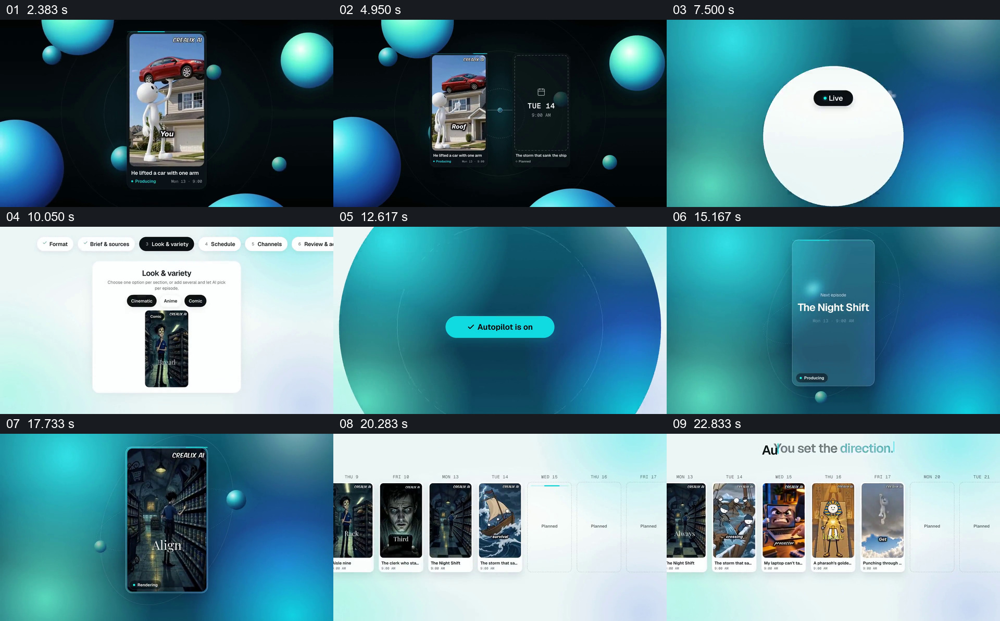

# 从一个竖屏示例进入系列设置，再展开排期

- 作品：案例 027《设置系列内容并排期》（索引名称）。
- 原片范围：00:02.000–00:25.000，含起点、不含终点；[完整原片](../video.mp4)｜[本卡片段](c01.mp4)。
- 观察方式：依据整片 64 宫格和约每秒一次的真实源帧观察，未连续原速观看或听审；声音、语气与完整播放节奏未确认。

## 原画面具体怎样设计

深色背景先出现一条竖屏视频及相邻日期卡。随后界面依次展示内容格式、主题输入、风格预览和发布渠道，再出现启用按钮及开启状态；一张竖屏内容从标题逐步填充画面，最后多张不同内容卡沿日期排开，标题提示持续创建。

## 为什么这样设计，好在哪里

先让观众看到目标内容的样子，再交代产生这类内容需要配置的选项；启用后从一张卡扩展到多张排期，使“系列”有可见结果。画面不能证明实际生成、定时发布或平台连接已执行。

以上为依据画面的分析，非作者自述；预期观看效果未经观众测试。

## 可直接使用的创意指令

当解释系列内容工作流时，先展示一条能代表最终形式的样例，再按真实流程说明主题、素材来源、视觉风格、时间和渠道；展示启用后的单条结果，并将实际条目放进可检查的排期。必要的审核和发布状态应按真实流程明确，示意卡不等于已发布。
