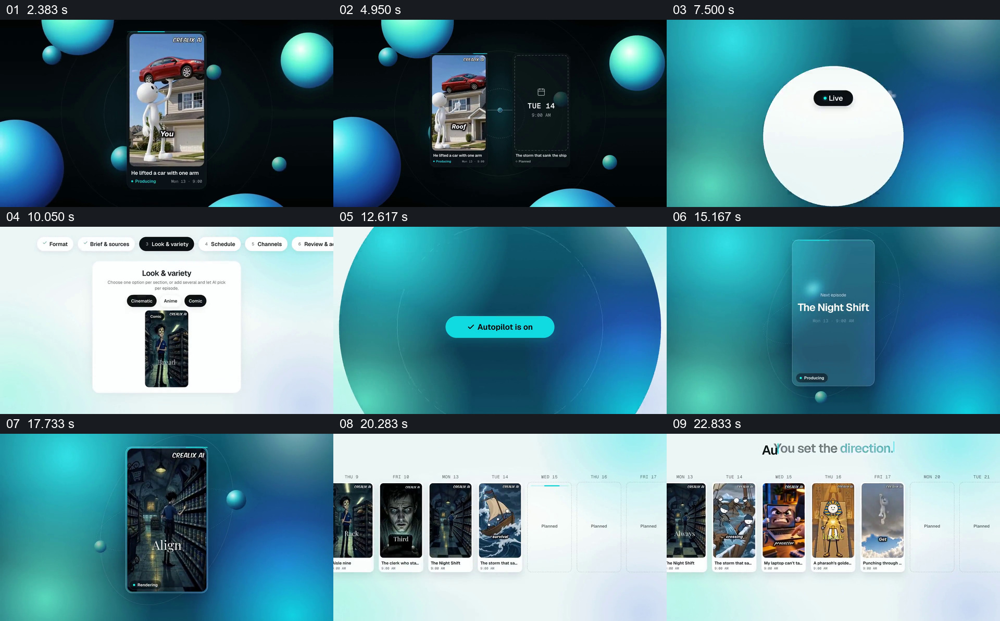

# 从一条竖屏样片进入设置，再把一集展开成连续排期

- 作品：案例 027《影像卡片与空间球体》（库内索引名称）。
- 原片范围：00:02.000–00:25.000，含起点、不含终点；[完整原片](../video.mp4)｜[本卡片段](c01.mp4)。
- 范围依据：从青蓝球体空间里的竖屏样片进入，保留设置、单集及多集排期的结果；之后画面转为品牌收尾。
- 观察方式与未确认范围：查看整片 64 帧总览和本卡分镜。未独立完成连续原速观看与听审；抽帧之间的运动、停顿与声音配合待复核。画面中的界面、数字与说明是作品呈现，未经额外核实；设计价值为基于画面的分析。

## 原画面具体怎样设计

深色空间中分布着远近不同的青蓝球体，中央是一张竖屏视频卡，白色人物与红车占据卡内画面，卡底有标题、状态和日期。右侧又出现一张带日期的待排卡：示例不再只是独立视频，也与下一期的时间位置并列。

画面转为青蓝渐变上的产品名称，再进入浅色界面；顶部依次列出格式、内容简述、视觉样式、排期和发布渠道，中央卡片随选项显示不同内容。出现“Autopilot is on”后，画面回到青蓝空间，一张竖屏卡显示 The Night Shift 标题、文案与声音样式，之后卡内呈现夜班故事图像，底部可见制作状态。

最终浅色的横向日期栏接过这张竖屏内容卡，多张不同故事卡与标有 Planned 的空位依日期排列，顶部出现设定方向和持续创作的说明。开头的单条内容、途中单集和最终多集虽然画面不同，始终以竖屏内容卡作为共同的观察对象。

## 为什么这样设计，好在哪里

先给出能识别的成片样子和旁边的待排位置，设置页面才有明确的用途；分步选项把复杂操作压缩为可理解的几类决定。回到单集时，标题、内容和状态让观众看到一次设定对应的具体结果，最后将它放入日期序列，才显出系列的持续性。

如果只展示设置界面，难以理解实际产物；如果直接堆满多集，观众又看不到单集与这些设定的关系。这里的界面和状态是作品演示，不足以证明真实生成或发布已经发生。

## 完整照排指令

以[完整原片](../video.mp4)的 2–25 秒为准。画幅 1280×720，源帧率 60/1。以下拍点为抽帧定位，位置按画幅百分比取近似值。

### 用料

【首集样片】【单集预览】【排期封面组】须能认作同一系列，至少一集可从设置和预览追溯至日程。备【系列名称】【功能标题】【设置字段组】【创建按钮】【单集状态】【排期日期组】【阶段标题组】【品牌标识】【片尾按钮】。实际排期提供可核对记录，注明计划与已发布状态。

### 按源时刻摆放

1. **2–约 5 秒。** 深黑蓝底，青色球体散在各角，有些越画边。竖向【首集样片】居中偏左，右侧少量幽暗待排位置，再用整幅青蓝渐变遮过去。动态样片在此窗内连续到过门。
2. **约 5–13 秒。** 青蓝渐变中轴建白粗【功能标题】。亮圆扩至满幅，接奶白设置页。顶部水平排细胶囊步骤，中轴白卡按顺序换【设置字段组】，先有小竖样图，再是选择项，保留已经选定的【系列名称】。白卡与顶部步骤分层。末拍借青蓝大圆压回深色并在中轴显【创建按钮】。静态截图可逐项显现，选项保持同一任务。
3. **约 13–18 秒。** 深青蓝渐变中部给窄竖卡，先是低亮【系列名称】和【单集状态】，再在同一中轴接【单集预览】。小球在四周点缀，不挡封面。若此处是视频，预览保持连续直到下一幕；若为生成封面，用定格即可。
4. **约 18–23 秒。** 浅色圆形扩大，形成排期横幅。把【单集预览】缩为日程格中的同一张封面，随后逐列铺【排期封面组】，上方小【排期日期组】与各格对应，标题【阶段标题组】在上中出现。先入卡保留到滚出，未填格留空。可用静照横移，禁止用不同集的图冒充同一条进度。
5. **约 23–25 秒。** 几道暗竖条切过浅版，回黑青球体环境。中央立亮青【品牌标识】与亮青【片尾按钮】，至 25.000 秒切出。

### 局部采用

有设置和单集可用约 5–18 秒。要采用 18–23 秒连续日程，需有多个独立可查的封面与排期点。

### 验证状态

已对照逐秒原片画序并读回，重点核对圆形遮挡、单集状态变为封面以及同一封面进入日期格。精确切帧、界面小字和换料待核。
