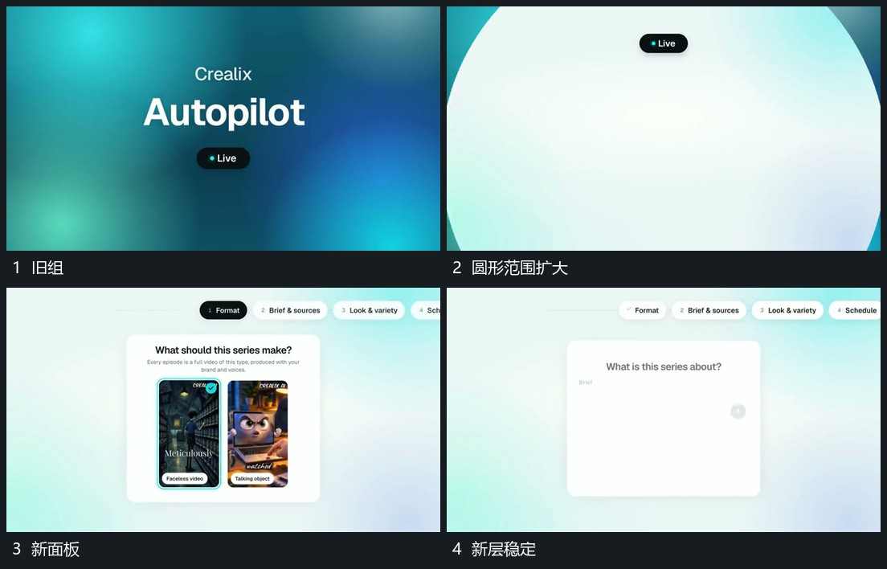

# 圆形可见范围扩大，新面板从内部接管

## 运动指令

从中部扩大圆形可见范围，露出新的底层与面板，圆边继续越出。主面板稳定后上方标签接入，下一动作在面板内发生。

## 视频切片

[播放本机制的原片切片](m02.mp4)

覆盖分镜中“旧组”至“新层稳定”的连续过程，并保留邻近的前后衔接画面；原片中交叠发生的动作一并保留。

## 分镜过程

## 组合与调整

保持开口中心对齐旧焦点，内层不能到末帧才突然出现。
