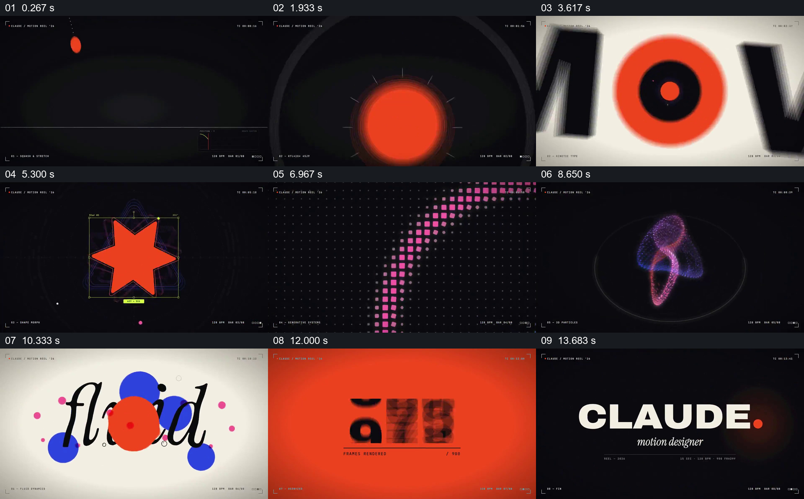

# 在一致的暗色框架内接力展示不同形式实验

- 作品：案例 117《图形、点阵与文字的快速作品集》（本次概括）。
- 原片范围：00:00.000–00:15.104，含起点、不含终点；[完整原片](../video.mp4)｜[本卡片段](../video.mp4)。
- 观察方式：依据约每秒一次的真实源帧观察，未连续原速观看或听审；声音、语气与完整播放节奏未确认。

## 原画面具体怎样设计

黑底小球和曲线之后出现橙色与蓝色大字，红色星形和三角形带着轮廓线接续；彩色点阵形成圆环和斜线，接着出现粒子球及暗色粒子空间。浅底彩色圆点覆盖手写字，黑色笔触从上方进入，橙色画面和品牌名称收尾。

## 为什么这样设计，好在哪里

重复的红蓝色、边缘界面和基础形状在快速变化中提供共同线索，彩色圆点覆盖手写字则把形状和排印组合到同一画面。抽帧可能遗漏快速变化，声音未听审。

以上为依据画面的分析，非作者自述；预期观看效果未经观众测试。

## 可直接使用的创意指令

展示多种形式实验时，保持少数共同颜色或边框，让每一组有清楚主体和独立的可辨状态；可让已有形状与文字重叠形成新组合，最后显示统一身份。具体切换、节奏及阅读时间需通过连续播放确认。
