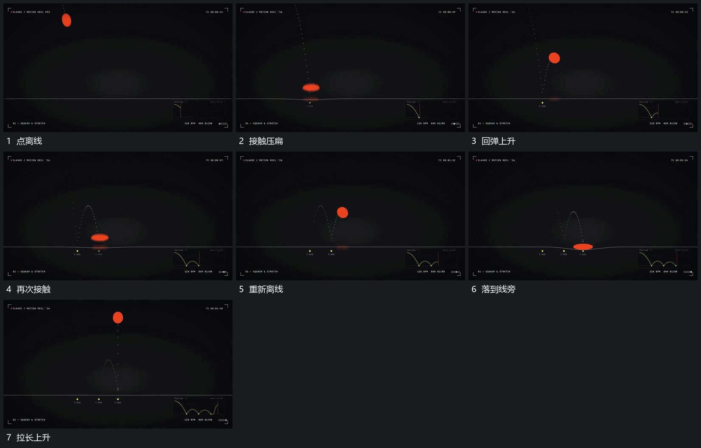

# 小点落到承托线压扁再拉长回弹

## 运动指令

让小点先离开承托线再向其下降，接近接触处拉长，接触时压扁并加宽，回弹时重新拉长再恢复。点在横向少量推进，留下可辨的落点顺序；每次接触都延续同一个点，承托线保持。

## 视频切片

[播放本机制的原片切片](m01.mp4)

覆盖分镜中“点离线”至“拉长上升”的连续过程，并保留邻近的前后衔接画面；原片中交叠发生的动作一并保留。

## 分镜过程

## 组合与调整

可调整反弹次数与高度；形变跟随接触和离线，不让压扁状态无缘由出现在半空。
