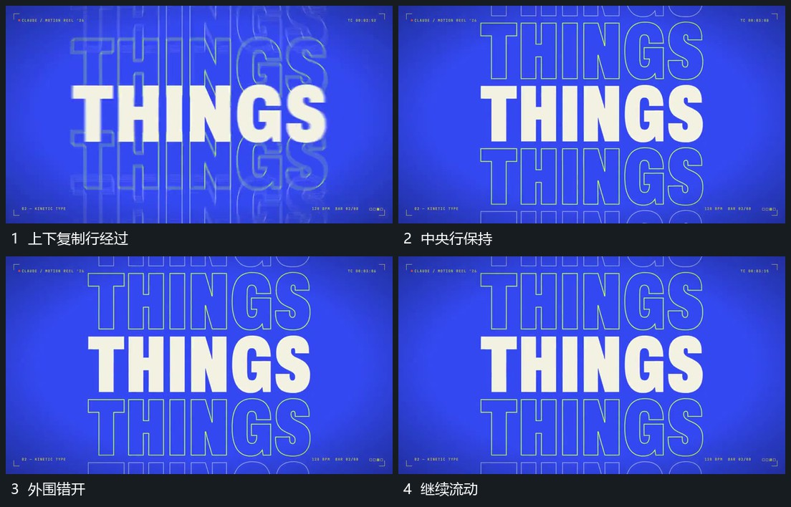

# 中央行保持上下复制行错开竖向流动

## 运动指令

保持中央一行的位置与可见范围，上下复制行沿竖向错开经过画面边缘。复制行共享字片排列但带不同竖向偏移，中央行不随它们整体滑走；外围越界的部分自然裁出。

## 视频切片

[播放本机制的原片切片](m03.mp4)

覆盖分镜中“上下复制行经过”至“继续流动”的连续过程，并保留邻近的前后衔接画面；原片中交叠发生的动作一并保留。

## 分镜过程

## 组合与调整

复制数量可减少；先确定中央参照，再让外围层流动，不把所有行当成同一块移动。
