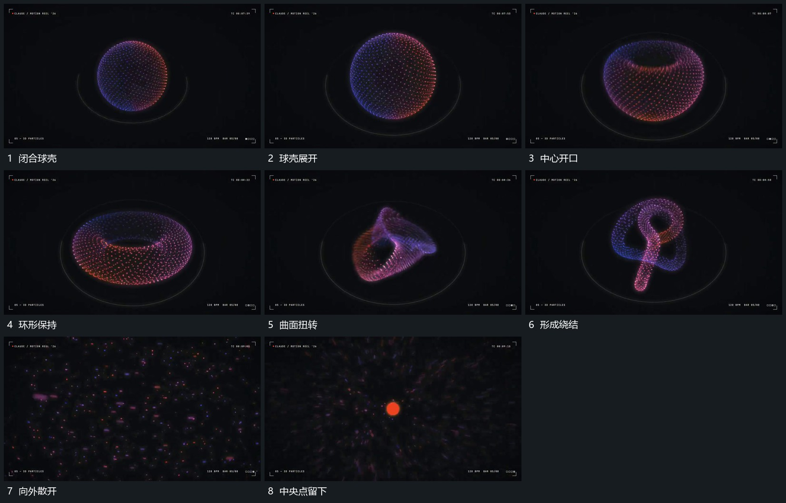

# 点群曲面由闭合球壳收成环再扭转散开

## 运动指令

让点群共同维持曲面，先扩大球壳，再将中心收出开口形成环。环形在转向中继续扭曲，局部曲面穿向不同深度；随后点群向外拉开并散出边缘，中央留下小点作下一段接点。

## 视频切片

[播放本机制的原片切片](m06.mp4)

覆盖分镜中“闭合球壳”至“中央点留下”的连续过程，并保留邻近的前后衔接画面；原片中交叠发生的动作一并保留。

## 分镜过程

## 组合与调整

借的是可见曲面变化，不宣称具体物理模型；开口和扭转要有中间状态，不能直接替换点群轮廓。
