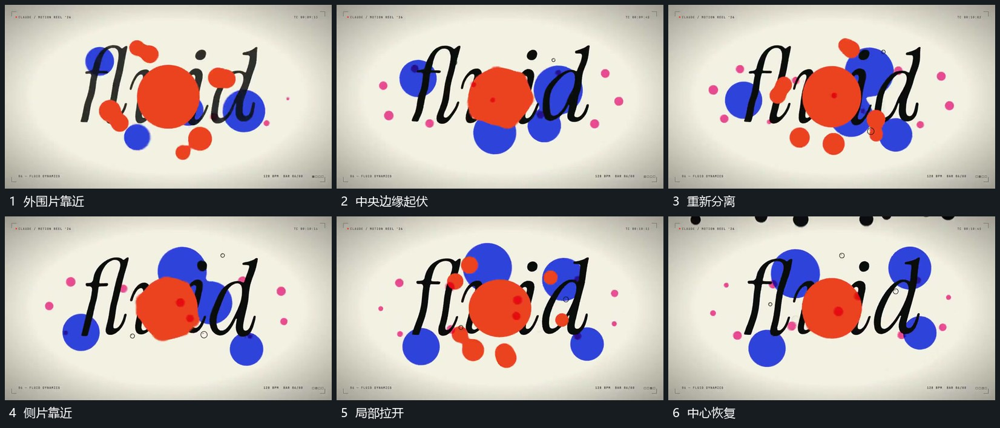

# 中央片边缘伸缩外围片靠近聚合再分离

## 运动指令

保持字行和中央位置，外围小片先靠近中央片，接触附近的边缘伸出并短暂连成整体，再缩回分离。外围片可从字片前后经过，但字行始终保持；相同聚散关系可重复，不每次换一套位置。

## 视频切片

[播放本机制的原片切片](m07.mp4)

覆盖分镜中“外围片靠近”至“中心恢复”的连续过程，并保留邻近的前后衔接画面；原片中交叠发生的动作一并保留。

## 分镜过程

## 组合与调整

可只保留少量外围片；新片的具体形状自定，靠近、相连和分开必须连续可辨。
