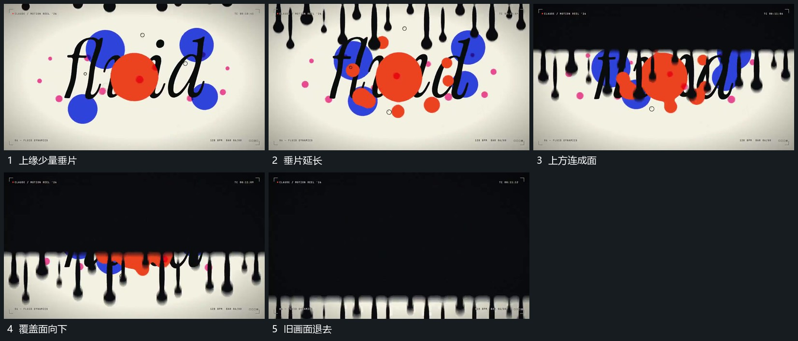

# 上缘垂片向下延长接成覆盖面

## 运动指令

从上边缘错开延长多个垂片，末端保持圆钝起伏。垂片之间逐步补成连续覆盖面，整面继续向下推进，旧画面在其后退出；不要先清空旧画面再播放覆盖层。

## 视频切片

[播放本机制的原片切片](m08.mp4)

覆盖分镜中“上缘少量垂片”至“旧画面退去”的连续过程，并保留邻近的前后衔接画面；原片中交叠发生的动作一并保留。

## 分镜过程

## 组合与调整

覆盖方向与垂片数量可改；保留前缘起伏和旧画面被逐步遮住的关系。
