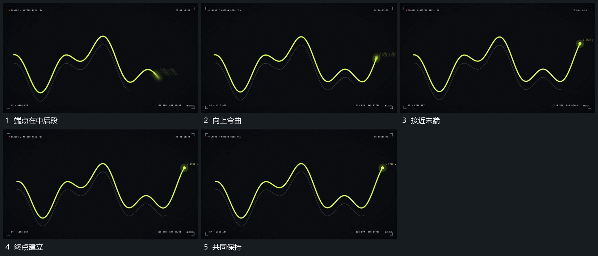

# 端点沿曲线路径前进身后线逐步延长

## 运动指令

让端点沿连续起伏的曲线路径前进，经过的线留在身后，未到的线不提前完整显示。端点接近末端时减小位移并保持，附近附属标记最后建立；背景参照曲线保持。

## 视频切片

[播放本机制的原片切片](m10.mp4)

覆盖分镜中“端点在中后段”至“共同保持”的连续过程，并保留邻近的前后衔接画面；原片中交叠发生的动作一并保留。

## 分镜过程

## 组合与调整

路线可重画；端点与新增长出的线必须对应，不能只让一个点在已完整显示的线上滑动冒充建立过程。
