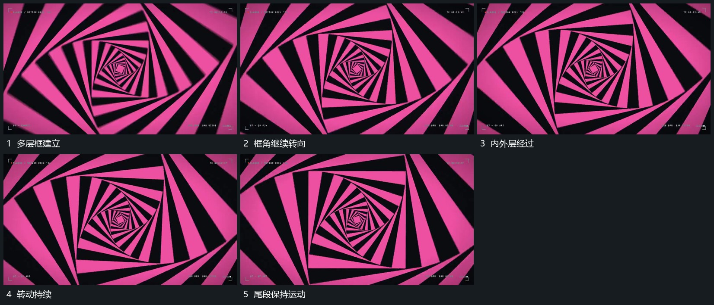

# 嵌套角框绕共同中心持续转向

## 运动指令

保持各层共同中心和由外到内递减的尺度，让嵌套框持续同向转角，各层保留角度差。外框越过边缘，内框仍可见，形成从外围指向中心的连续参照；离开时按整组运动切出。

## 视频切片

[播放本机制的原片切片](m15.mp4)

覆盖分镜中“多层框建立”至“尾段保持运动”的连续过程，并保留邻近的前后衔接画面；原片中交叠发生的动作一并保留。

## 分镜过程

## 组合与调整

层数和转角差可减少；仅依据可见投影描述转向，不推定真实镜头穿行或无限循环算法。
