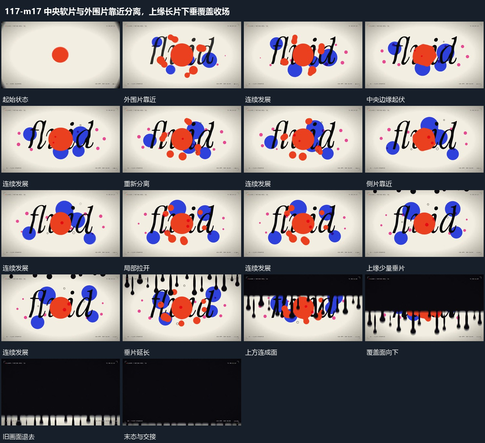

# 中央软片与外围片靠近分离，上缘长片下垂覆盖收场

## 运动指令

中央片边缘伸缩，外围片靠近聚合又分开；局部运动仍延续时上缘片向下拉长，逐渐连成覆盖面完成交接。

1. **中央片边缘伸缩外围片靠近聚合再分离**

保持字行和中央位置，外围小片先靠近中央片，接触附近的边缘伸出并短暂连成整体，再缩回分离。外围片可从字片前后经过，但字行始终保持；相同聚散关系可重复，不每次换一套位置。

2. **上缘垂片向下延长接成覆盖面**

从上边缘错开延长多个垂片，末端保持圆钝起伏。垂片之间逐步补成连续覆盖面，整面继续向下推进，旧画面在其后退出；不要先清空旧画面再播放覆盖层。

整段结束：覆盖面沿下方越界 保留必要落稳与交接，中间已建立的参照沿用到下一步骤。

## 视频切片

[播放本机制的原片切片](m17.mp4)

保留起始准备、连续发展和完成或明确交接；首尾按本段运动范围裁切，不拼接、不变速。相连的小动作合为同一完整段落。

## 分镜过程

## 组合与调整

中央片边缘伸缩，外围片靠近聚合又分开；局部运动仍延续时上缘片向下拉长，逐渐连成覆盖面完成交接。 复用时可调整元素数量、幅度和相对节奏，保留上述进入、交叠与完成关系；不直接沿用原片题材或时长。

可只保留少量外围片；新片的具体形状自定，靠近、相连和分开必须连续可辨。

覆盖方向与垂片数量可改；保留前缘起伏和旧画面被逐步遮住的关系。
