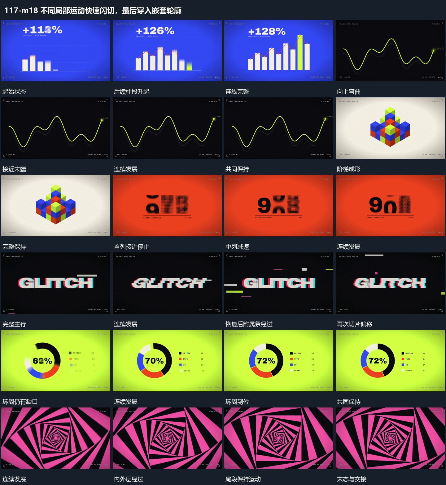

# 不同局部运动快速闪切，最后穿入嵌套轮廓

## 运动指令

以连续短切接力：柱段增长与连线跟随、曲线端点推进、柱组改高、窗口字片滚动落定、横条切分错位复原、圆弧延长和中央数值收稳；最后嵌套轮廓围中心转向并深入。

1. **柱段沿同一底线依次升起连线跟随端点**

沿共同底线从左向右错开抬升柱段，先到位的段保持，后段继续长高。折线沿已建立的段顶接续前进，各端点随对应柱高到位，直到整组可见；上方附属行同步更新后停住。

2. **端点沿曲线路径前进身后线逐步延长**

让端点沿连续起伏的曲线路径前进，经过的线留在身后，未到的线不提前完整显示。端点接近末端时减小位移并保持，附近附属标记最后建立；背景参照曲线保持。

3. **固定柱组收回高段并重排高度形成阶梯**

保留柱组的底部格位，中央高段向下回收，周边段在原格位抬升或降低，形成新的阶梯体量。各段的变化错开交叠，取景和底部参照保持，使观众能跟随同一柱组的重排。

4. **固定窗口内的字片竖向滚动逐列停稳**

将每列字片限制在同一高度窗口内，字片沿竖向连续经过，越界部分裁去。各列错开减小位移并停在共同基线上，已停列保持，末列停止后整行稳定；窗口上下边界不跟字片移动。

5. **主行被横向条带错开后回到完整排列**

保持主行的整体位置，将局部横向带错开向两侧位移，随后回到原排列；不同带的幅度和发起顺序不一致，外围短条同时经过。每轮之间保留完整主行作为参照，不能只让整行一起抖动。

6. **分段环沿同一圆周延长中心行同步收稳**

固定环的中心与半径，让各段沿同一圆周延长，缺口逐步缩小。中心短行持续变化并逐渐停稳，侧边附属行依次齐全；环周完成后共同保持，不让整体圆环随段长变化平移。

7. **嵌套角框绕共同中心持续转向**

保持各层共同中心和由外到内递减的尺度，让嵌套框持续同向转角，各层保留角度差。外框越过边缘，内框仍可见，形成从外围指向中心的连续参照；离开时按整组运动切出。

整段结束：框组继续同向转动后切出 保留必要落稳与交接，中间已建立的参照沿用到下一步骤。

## 视频切片

[播放本机制的原片切片](m18.mp4)

保留起始准备、连续发展和完成或明确交接；首尾按本段运动范围裁切，不拼接、不变速。相连的小动作合为同一完整段落。

## 分镜过程

## 组合与调整

以连续短切接力：柱段增长与连线跟随、曲线端点推进、柱组改高、窗口字片滚动落定、横条切分错位复原、圆弧延长和中央数值收稳；最后嵌套轮廓围中心转向并深入。 复用时可调整元素数量、幅度和相对节奏，保留上述进入、交叠与完成关系；不直接沿用原片题材或时长。

柱高与数量由新内容决定，不继承原数字；不要等所有柱段静止后才突然补出整条线。

路线可重画；端点与新增长出的线必须对应，不能只让一个点在已完整显示的线上滑动冒充建立过程。

不据画面推定实际积木移动方式；可用几根柱段复现高度重组，保持格位与前后遮挡。

可用于任何短排列；不继承原数值，重点是列内滚动、边界裁切和逐列收势。

可降低切片数量与偏移；借的是分带关系和恢复过程，颜色与材质由新片决定。

段数与各段占比由新内容决定；不把原数字或环段数量当作机制要求。

层数和转角差可减少；仅依据可见投影描述转向，不推定真实镜头穿行或无限循环算法。
