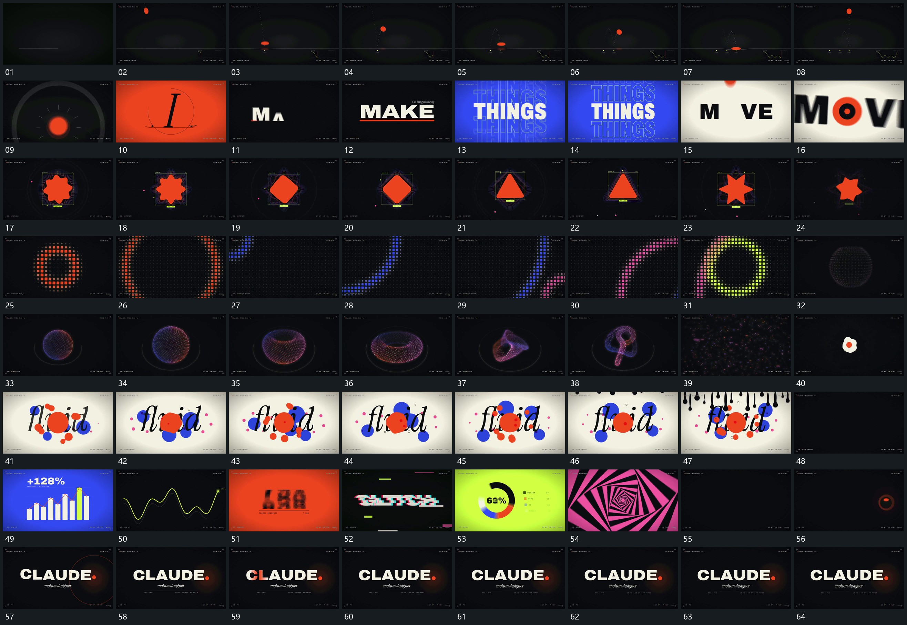

# 117｜原片运动总览

[观看完整原片](video.mp4)

## 运动总览

全片先用小点落到承托线压扁再拉长回弹建立点与承托线的反复接触，再快速切入几组字行：字片从下方错开进入主行底线随后延长让字片逐个从下方进入，中央行保持上下复制行错开竖向流动让中央行与上下复制行形成相对运动。这几段以直接切换衔接，不把它们写成同一个持续变形。

中央形用中央形连续变换轮廓外围轮廓延后跟随在固定中心连续改换轮廓，随后切到固定格阵中的亮区形成轮廓并放大经过边界的格阵亮区，再切到点群曲面由闭合球壳收成环再扭转散开的点群曲面。点群散开后，中央局部接到中央片边缘伸缩外围片靠近聚合再分离的聚合与分离；上缘再以上缘垂片向下延长接成覆盖面向下覆盖旧画面。

中后段快速展示柱段沿同一底线依次升起连线跟随端点的柱段与连线、端点沿曲线路径前进身后线逐步延长的路径端点、固定柱组收回高段并重排高度形成阶梯的柱组高度重排、固定窗口内的字片竖向滚动逐列停稳的窗口滚动、主行被横向条带错开后回到完整排列的条带错位、分段环沿同一圆周延长中心行同步收稳的分段环周延长和嵌套角框绕共同中心持续转向的嵌套框转向。这些短过程之间多为直接切换，没有共同物体穿过所有段落。最后重新出现点与环，接回字片从下方错开进入主行底线随后延长建立完整主行和下方附属行，保持结束。

## 完整运动段落

以下按原片中的出现顺序引用。建立、内部发展及完成反馈放在同一段中；同时发生的局部动作与运镜写在同一份指令里。不同段之间可以是连续接管，也可以是直接切换，不能仅凭条目相邻认定可直接拼接。重复出现的同类运动采用一次连续代表范围，切片不以逐段无缝覆盖整片为目标。

1. [小点落到承托线压扁再拉长回弹](mechanisms/m01.md)：下降接触变形回弹

2. [字片错峰进入并补下线，接替行留在中央而复制行竖向经过](mechanisms/m16.md)：字片从下方错峰进入并落在共同基线，下线随后拉长；换入的新行留在中央，上下复制行错开竖向滚动，完成一次字组接力。

3. [中央形连续变换轮廓外围轮廓延后跟随](mechanisms/m04.md)：中心形变外围滞后

4. [固定格阵中的亮区形成轮廓并放大经过边界](mechanisms/m05.md)：格位保持区域扩大经过

5. [点群曲面由闭合球壳收成环再扭转散开](mechanisms/m06.md)：曲面变形后散开

6. [中央软片与外围片靠近分离，上缘长片下垂覆盖收场](mechanisms/m17.md)：中央片边缘伸缩，外围片靠近聚合又分开；局部运动仍延续时上缘片向下拉长，逐渐连成覆盖面完成交接。

7. [不同局部运动快速闪切，最后穿入嵌套轮廓](mechanisms/m18.md)：以连续短切接力：柱段增长与连线跟随、曲线端点推进、柱组改高、窗口字片滚动落定、横条切分错位复原、圆弧延长和中央数值收稳；最后嵌套轮廓围中心转向并深入。

切片保留起始准备、必要内部停顿和完成或明确交接；首尾省略无新发展的等待，持续运动不要求人为停住。以上基于真实源帧序列和重点边界核对，不等同于全片连续声画审片。

## 完整64宫格

