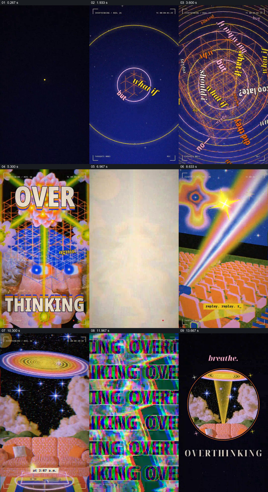

# 让一个念头扩散成密集拼贴，再收回到呼吸

- 作品：案例 072《过度思考的视觉拼贴》（本次概括）。
- 原片范围：00:00.000–00:15.061，含起点、不含终点；[完整原片](../video.mp4)｜[本卡片段](../video.mp4)。
- 观察方式：依据约每秒一次的真实源帧观察，未连续原速观看或听审；声音、语气与完整播放节奏未确认。

## 原画面具体怎样设计

竖画幅的深色空间中先出现小亮点和 one thought 字样，随后圆环、斜置文字和多重轨迹填满画面；人物面部、鲜亮花朵与网格叠合，OVER 和 THINKING 夹住画面。接着光束、道路、天空、沙发等拼贴依次出现，重复文字密布；末尾画面突然收回黑底，一个圆形窗口中保留沙发和光束，上方写 breathe，下方出现 OVERTHINKING。

## 为什么这样设计，好在哪里

由单点到密集字形和多层图像的变化，使“想法越来越多”成为可见的形式变化；末尾把繁杂内容缩进一个圆形窗口并留出大面积空白，让停顿与前面的密集形成对照。这是作品分析，不是对心理状态的临床解释。

以上为依据画面的分析，非作者自述；预期观看效果未经观众测试。

## 可直接使用的创意指令

需要呈现思绪堆叠时，从一个明确可识别的念头开始，让相关文字、路径或图像逐步叠加并改变画面密度；在结束处保留一个前面出现过的元素，将其收进清晰的局部并留下呼吸空间。视觉素材和文字应与具体内容相符，避免把抽象拼贴当作心理诊断。
