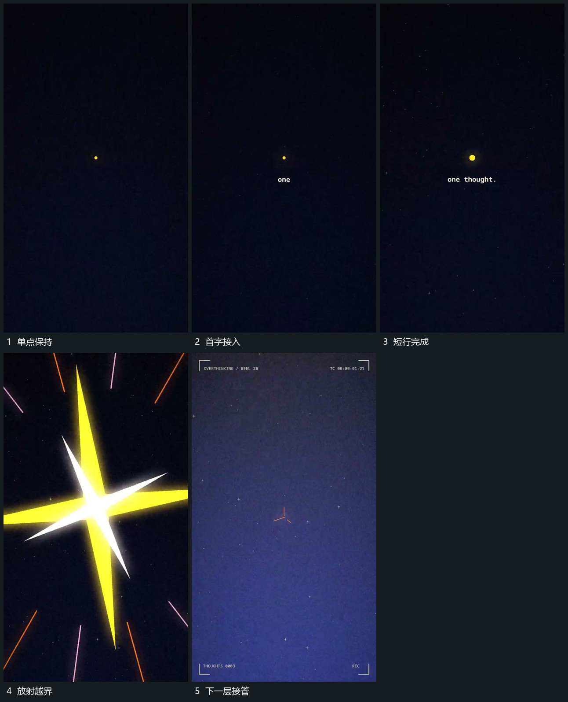

# 点下方补字再由中心放射覆盖

## 运动指令

先让中央小点保持位置，在其下方逐步补出短行。短行完成后退弱，交叉长条从原中心向外伸展，宽度与长度一起增加并越过边缘。下一层在覆盖经过后接入，中心仍作为新的运动起点。

## 视频切片

[播放本机制的原片切片](m01.mp4)

覆盖分镜中“单点保持”至“下一层接管”的连续过程，并保留邻近的前后衔接画面；原片中交叠发生的动作一并保留。

## 分镜过程

## 组合与调整

可改变长条数量与方向，保留由单点到覆盖的尺度变化；接续时让下一层的中心与原点对齐。
