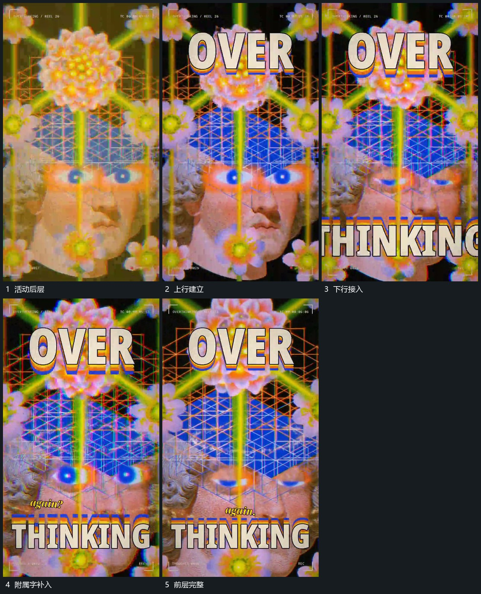

# 前层大字分段建立而后层继续活动

## 运动指令

保持后层图块和线网的局部活动，先在上方建立一行大字，再让下方大字接入。附属短字随后在两行之间分次补齐；已完成的大字保持位置，不随后层来回移动。最后让前层放大，为向内推进预留入口。

## 视频切片

[播放本机制的原片切片](m03.mp4)

覆盖分镜中“活动后层”至“前层完整”的连续过程，并保留邻近的前后衔接画面；原片中交叠发生的动作一并保留。

## 分镜过程

## 组合与调整

可换成两组几何片；关键是先后层分工，前层稳定后后层仍有连续变化。
