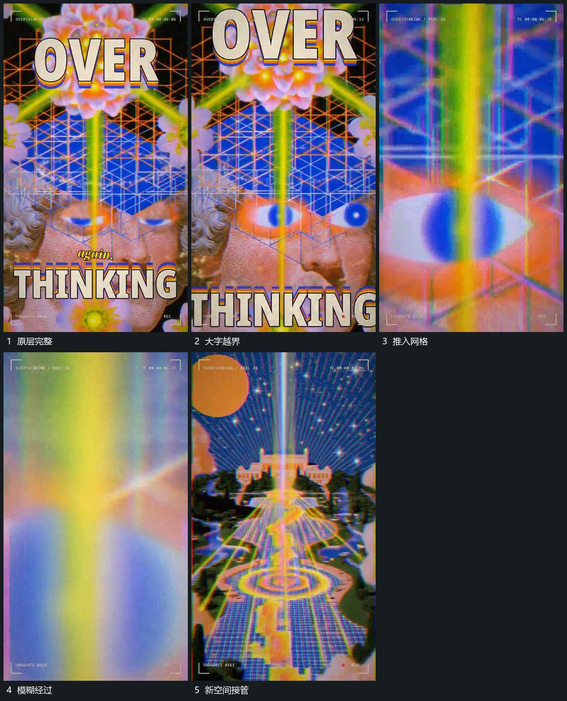

# 推入中心网格并穿过模糊遮挡接管新空间

## 运动指令

先放大前层直到字边越过画面，继续沿中心网格向内推进。网格和内部图块在靠近中快速放大，经过近处遮挡时暂时变得模糊。遮挡通过后让新空间完整接管，同一中心轴继续保留在画面中。

## 视频切片

[播放本机制的原片切片](m04.mp4)

覆盖分镜中“原层完整”至“新空间接管”的连续过程，并保留邻近的前后衔接画面；原片中交叠发生的动作一并保留。

## 分镜过程

## 组合与调整

可改变通道方向，进入与退出保持同向推进；不要在遮挡前停住再突然更换空间。
