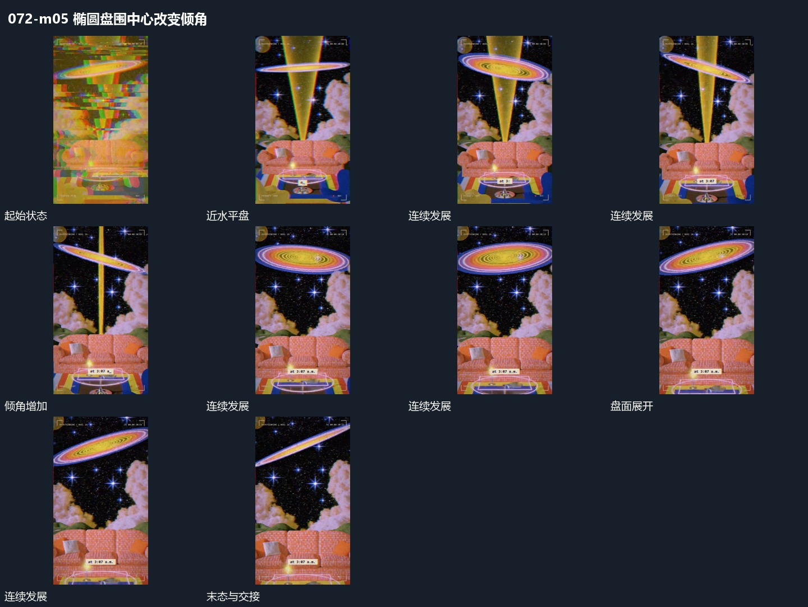

# 椭圆盘围中心改变倾角

## 运动指令

保留下方轴形与盘面的中心接点，让椭圆盘绕该接点改变倾角。盘的近边下移、远边抬高，内部纹理随盘面一起转向，椭圆投影由窄变宽。其他层保持位置，使转角可以在同一参照下辨认。

## 视频切片

[播放本机制的原片切片](m05.mp4)

保留起始准备、连续发展和完成或明确交接；首尾按本段运动范围裁切，不拼接、不变速。尾部只保留理解结果所需的展示。

## 分镜过程

## 组合与调整

转向可往返，不必整盘绕画面移动；下一机制可从盘面最展开的状态进入。
