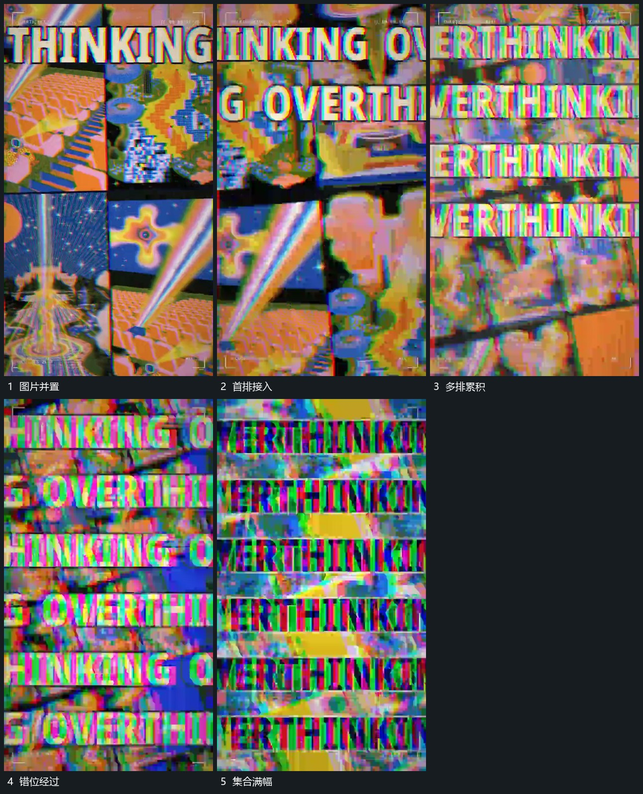

# 多片并置后多排字错位铺满

## 运动指令

先把不同图片并置成集合，保留各片内部变化。多行长字随后从边缘接入，不同排错开起点并持续横向经过；后层片面也改变位置和局部比例。让行与片逐渐铺满边界，直到集合整体退出。

## 视频切片

[播放本机制的原片切片](m06.mp4)

覆盖分镜中“图片并置”至“集合满幅”的连续过程，并保留邻近的前后衔接画面；原片中交叠发生的动作一并保留。

## 分镜过程

## 组合与调整

可减少排数；不同排要有相对位移，避免全部成为一个静止文字块。
