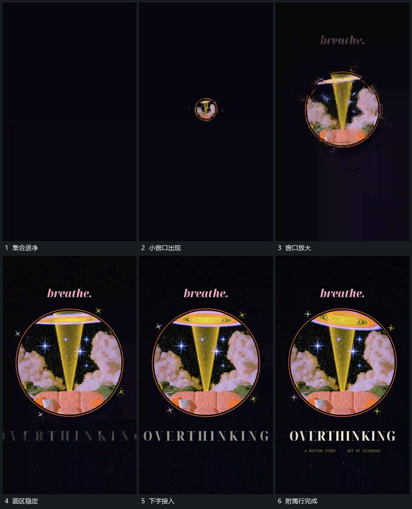

# 集合退净后圆窗口由小放大并补下方字行

## 运动指令

等满幅集合退净后，在中央建立很小的圆窗口，窗口内保留活动图层。圆边界向外放大，到稳定范围后保持；上方短行随窗口建立，下方主行再分段展开，最后补出附属行。外围小点只作短促经过，不改变窗口位置。

## 视频切片

[播放本机制的原片切片](m07.mp4)

覆盖分镜中“集合退净”至“附属行完成”的连续过程，并保留邻近的前后衔接画面；原片中交叠发生的动作一并保留。

## 分镜过程

## 组合与调整

可接入任意连续内部运动；窗口放大结束后再强化下行，避免同时放大两组主层。
