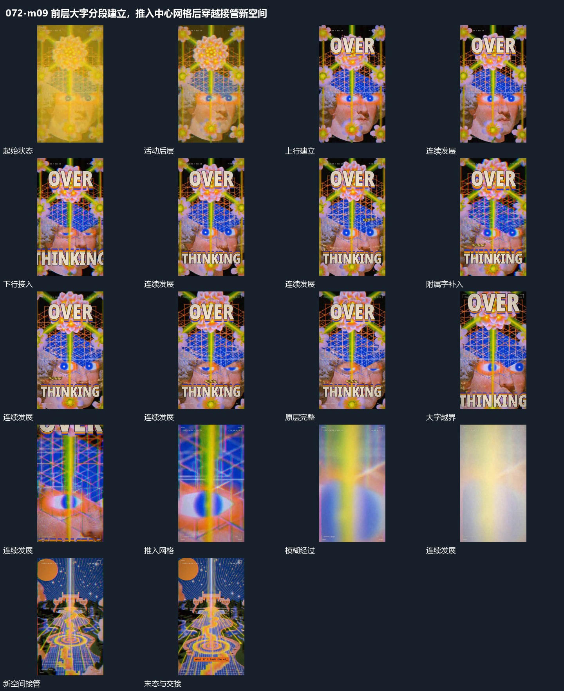

# 前层大字分段建立，推入中心网格后穿越接管新空间

## 运动指令

后层持续活动时前字分段接入，随后向中心网格推进，经过模糊遮挡进入新的纵深空间。

1. **前层大字分段建立而后层继续活动**

保持后层图块和线网的局部活动，先在上方建立一行大字，再让下方大字接入。附属短字随后在两行之间分次补齐；已完成的大字保持位置，不随后层来回移动。最后让前层放大，为向内推进预留入口。

2. **推入中心网格并穿过模糊遮挡接管新空间**

先放大前层直到字边越过画面，继续沿中心网格向内推进。网格和内部图块在靠近中快速放大，经过近处遮挡时暂时变得模糊。遮挡通过后让新空间完整接管，同一中心轴继续保留在画面中。

整段结束：新空间占满画面 保留必要落稳与交接，中间已建立的参照沿用到下一步骤。

## 视频切片

[播放本机制的原片切片](m09.mp4)

保留起始准备、连续发展和完成或明确交接；首尾按本段运动范围裁切，不拼接、不变速。相连的小动作合为同一完整段落。

## 分镜过程

## 组合与调整

后层持续活动时前字分段接入，随后向中心网格推进，经过模糊遮挡进入新的纵深空间。 复用时可调整元素数量、幅度和相对节奏，保留上述进入、交叠与完成关系；不直接沿用原片题材或时长。

可换成两组几何片；关键是先后层分工，前层稳定后后层仍有连续变化。

可改变通道方向，进入与退出保持同向推进；不要在遮挡前停住再突然更换空间。
