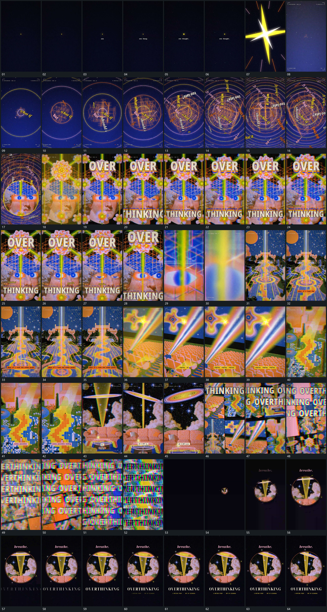

# 072｜原片运动总览

[观看完整原片](video.mp4)

## 运动总览

全片从单点开始，以点下方补字再由中心放射覆盖让短字接入并用放射覆盖打开下一层。随后环网格累积并让短字沿不同方向绕行逐步增加环、网格和绕行短字，中心窗口引入图块，接到前层大字分段建立而后层继续活动的前层文字建立与后层持续活动。

文字放大越界后，推入中心网格并穿过模糊遮挡接管新空间沿中心通道推入并穿过遮挡，转到新的纵深空间；其中的平面与短条继续接替。椭圆盘围中心改变倾角在稳定中心下改变椭圆盘的倾角，再以多片并置后多排字错位铺满让多片和多行同时铺开、错位经过。集合退净后，集合退净后圆窗口由小放大并补下方字行用小圆窗口逐步放大收尾，窗口内复用椭圆盘围中心改变倾角，下方文字分项补齐。

## 完整运动段落

以下按原片中的出现顺序引用。建立、内部发展及完成反馈放在同一段中；同时发生的局部动作与运镜写在同一份指令里。不同段之间可以是连续接管，也可以是直接切换，不能仅凭条目相邻认定可直接拼接。重复出现的同类运动采用一次连续代表范围，切片不以逐段无缝覆盖整片为目标。

1. [中心放射换底，圆环与网格接力累积并绕行](mechanisms/m08.md)：中央点和短字先建立，放射覆盖换入新底；多圈与网格逐层累积，短字沿不同方向绕行。

2. [前层大字分段建立，推入中心网格后穿越接管新空间](mechanisms/m09.md)：后层持续活动时前字分段接入，随后向中心网格推进，经过模糊遮挡进入新的纵深空间。

3. [椭圆盘围中心改变倾角](mechanisms/m05.md)：局部转向下层保持

4. [多片并置后多排字错位铺满](mechanisms/m06.md)：并置累积后错位经过

5. [集合退净后圆窗口由小放大并补下方字行](mechanisms/m07.md)：窗口先建立字行后补齐

切片保留起始准备、必要内部停顿和完成或明确交接；首尾省略无新发展的等待，持续运动不要求人为停住。以上基于真实源帧序列和重点边界核对，不等同于全片连续声画审片。

## 完整64宫格

