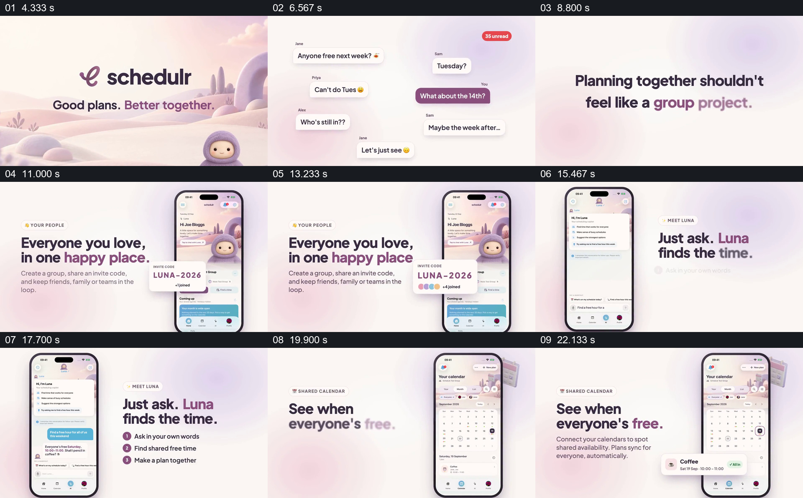

# 先让群聊里的相约困难可见，再走到共同日历

- 作品：案例 048《手机、角色与协作场景》（库内索引名）。
- 原片范围：00:04.000–00:24.000，含起点、不含终点；[完整原片](../video.mp4)｜[本卡片段](c01.mp4)，片段起点对应原片 4.000 秒。
- 范围依据：4–24 秒含聊天问题、参与者加入、查询建议和具体日历结果，作为一套共同安排的过程；前后主要为品牌引入和功能、品牌汇总。
- 观察方式：核看全片 64 帧总览及本卡九宫格；未独立连续原速观看，快速变化和运动节奏待核。未独立听审，声音内容未知。片中事实和演示未独立查证，新题材迁移尚未实测。

## 原画面具体怎样设计

暖白色渐变背景上，几个人的聊天气泡分散在左右：“下周谁有空”“周二呢”“周二不行”“14 日怎样”等，角上的红色未读数字增加；气泡退去，中央出现 “Planning together shouldn’t feel like a group project.”。这不是对话截图的简单放大，而是把无法对齐的回答分布在整个画面中。

之后手机进入右侧，左侧文字介绍将亲友放在一组；设备前方提出邀请码卡，卡上陆续出现彩色头像圆点和加入人数，手机仍显示同一群组主页。下一组改为左侧手机、右侧说明：屏内有向 Luna 提问的消息及建议共同空闲时间，右侧三行说明依次标示提问、找时间和共同制定计划。

最后右侧手机显示月历及参与者，左侧写 “See when everyone’s free.”，屏外前景提出一张咖啡活动卡，显示日期、时段和 “All in” 状态。群聊、成员、日历与确认状态是片中示例，无法仅凭动画验证真实同步、人员同意或助手能力。

## 为什么这样设计，好在哪里

分散的消息让协调成本先成为可以阅读的日常情境，未读数强化消息不断堆积；随后不是直接展示一个空日历，而是先让参与者通过同一个邀请码进入共同空间，再给出提问、建议和日历中的安排。邀请码卡上的头像和人数让“大家加入”获得具体的可见反馈；固定的手机与左右短文使不同阶段仍属于同一产品叙述。最后的活动卡把共同时间收束成具体计划，而不是只留下抽象的日历。

这套讲法依赖前面的真实协调难题、参与者身份以及最后可辨认的安排之间存在联系；仅堆砌手机界面会削弱问题到结果的路径。以上为对画面的分析，不是自动排期或用户感受的验证。

## 可直接使用的创意指令

演示多人协调时，先选取经授权或明确为模拟的具体冲突：让几位参与者对时间给出不同回复，并让问题可以从画面读懂。随后说明这些人怎样进入共同空间，以人员、加入状态或其他明确反馈确认参与；再展示一次可核对的时间查询及其依据，最后把同一群人的候选或确认安排放回可读的日历或事件卡。手机、聊天样式、助手角色与配色可因项目变化，但应保留问题、参与者和结果的对应；个人日历权限及确认状态须按真实情况呈现，模拟画面不代表已经获得同意。
