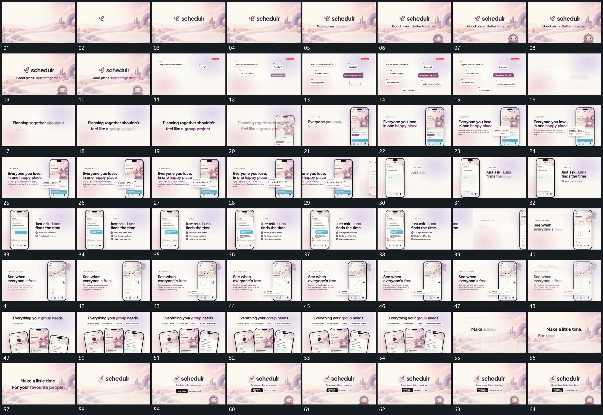

# 048｜原片运动总览

[观看完整原片](video.mp4)

## 运动总览

开头字组分项建立，下方小形从边缘接入。分散气泡逐项增加，角上数值增长后整组退虚 将短气泡从少到多铺在分散位置，角上数值增加，之后整组退虚并收向中心。字组逐行建立，竖框侧下接入，原字退弱后新旁字分行建立 从侧下接入竖框，原字退弱，新的旁字补齐。

中段 框内局部片前提，小标记逐项增加 将框内局部片提到前层，片内小标记依次增加；框内气泡逐行补入，旁侧列表按同一推进追加 让固定框内气泡分行补入，同时旁侧列表逐项建立。下一竖框接管后，局部下片再次外提。多个竖框错开展开成扇形，顶部短标签随后补齐 把多个竖框错开展开成扇形群组，上标签逐项补齐。末段群组退出，后层接手，字组与附属条逐项建立，小形再次从下边缘接入保持。

## 完整运动段落

以下按原片中的出现顺序引用。建立、内部发展及完成反馈放在同一段中；同时发生的局部动作与运镜写在同一份指令里。不同段之间可以是连续接管，也可以是直接切换，不能仅凭条目相邻认定可直接拼接。重复出现的同类运动采用一次连续代表范围，切片不以逐段无缝覆盖整片为目标。

1. [分散气泡逐项增加，角上数值增长后整组退虚](mechanisms/m01.md)：气泡累计，数值接续，整体最后退出

2. [竖框从侧下接入，字组建立后局部卡前提并补标记](mechanisms/m06.md)：竖框侧下进入时旧字退弱，新字分行建立；同一框的局部卡随后向前提出，小标记依次增加形成强调结果。

3. [框内气泡逐行补入，旁侧列表按同一推进追加](mechanisms/m04.md)：气泡增加，外列表接续

4. [多个竖框错开展开成扇形，顶部短标签随后补齐](mechanisms/m05.md)：框先展开，标签再追加

切片保留起始准备、必要内部停顿和完成或明确交接；首尾省略无新发展的等待，持续运动不要求人为停住。以上基于真实源帧序列和重点边界核对，不等同于全片连续声画审片。

## 完整64宫格

