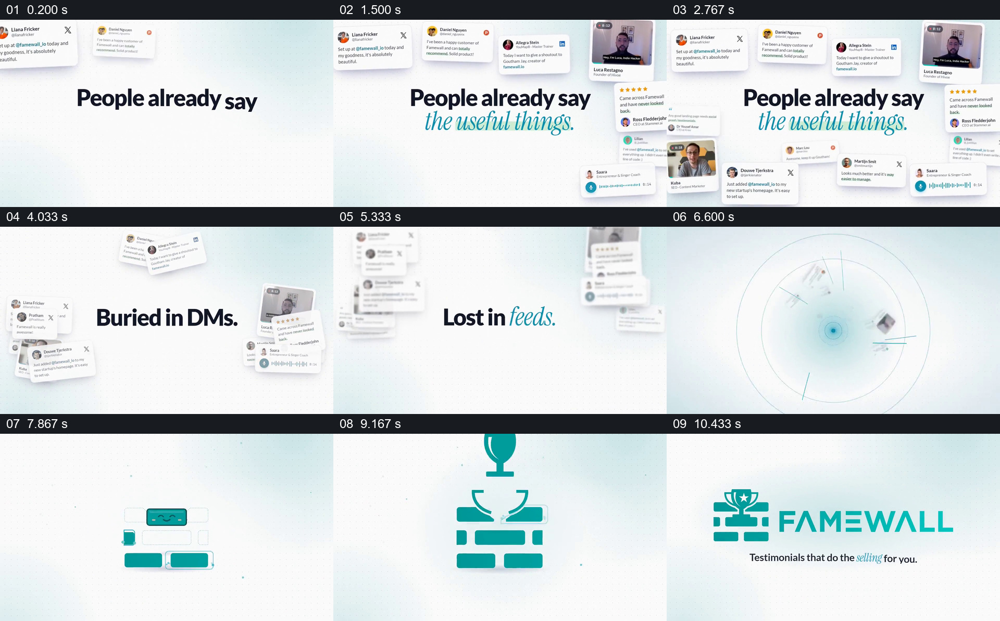

# 评价散落四周，再把分散的内容收进产品标识

- 作品：案例 009，原片中的 FAMEWALL 产品展示。
- 原片范围：00:00.000–00:11.500（源时间，起点包含、终点不包含）；[完整原片](../video.mp4)｜[本卡片段](c01.mp4)。
- 观察方式与未确认范围：查看原片 64 帧总览和本卡九宫格；未独立连续原速观看及听审，抽帧之间的动作衔接、速度、停留和声音配合待复核。评价、数据与界面按片中演示记录，未核实真实性；迁移尚未实测。

## 原画面具体怎样设计

浅色点阵底中，中央先出现黑色“People already say”，青色斜体补出“the useful things.”。不同大小的评价卡分布在画面边缘：有文字、头像、平台标记，也有带人物画面或波形的卡；中央句子保有阅读空间，评价不是一开始就被压成难辨的一团。

接着中央文字依次变为“Buried in DMs.”与“Lost in feeds.”，先前的评价卡移至周围并出现堆叠、模糊等状态。那些原来能阅读的卡片此时仍可辨认是评价，但不再每条占据清楚位置。约 00:06.6，卡片落入由同心线构成的圆形区域，画面中心留下青色小角色；之后角色与青色条块被安排成墙状图形，上方奖杯加入，旁边显示 FAMEWALL 标识与一句简短说明。本卡到约 11.5 秒，下一段进入具体的收集方式。

## 为什么这样设计，好在哪里

这段的视觉问题不是“缺少评价”，而是“评价已经存在，却分散在不同地方”。同一类评价先在句子四周呈现为可辨的内容，再被堆到外围并变得难读，中心文字因此从陈述转为问题；如果一开始只显示一个品牌标识，观众不知道这些文字、人物和音频卡为何需要被组织。

收拢后，青色小角色和墙形条块成为新的注意力中心，随后由墙和奖杯组合为品牌身份。视觉上的收集与排列为产品名称提供了来处，而不是凭空插入标版。以上是依据作品画面作出的分析；卡中姓名、评价及品牌主张的真实性没有独立核实。

## 可直接使用的创意指令

当真实内容确有多个分散的反馈来源，先挑选类型不同但有共同主题的评价，用原有来源线索或获得授权的替代呈现让它们围绕一句核心陈述出现；给文字留出阅读空间，使观众先认识“已有内容”。再依据实际问题让这些卡片分散、叠放、缩小或退到边缘，以中央短句指出它们为何难以使用。

将原来的反馈作为持续参照，逐步把注意力收向代表整理动作的对象；当这个对象接手后，可把反馈转为可辨的集合或容器，再引出产品、团队或下一步工作。保留“先可辨—再显露分散问题—最后出现组织入口”的关系；颜色、卡片形状、吉祥物和标识构成均可重做。若没有真实评价或来源不明，应明确使用示意材料；需要逐条核验时，让评价有足够阅读时间，不以快速堆叠代替证据。
