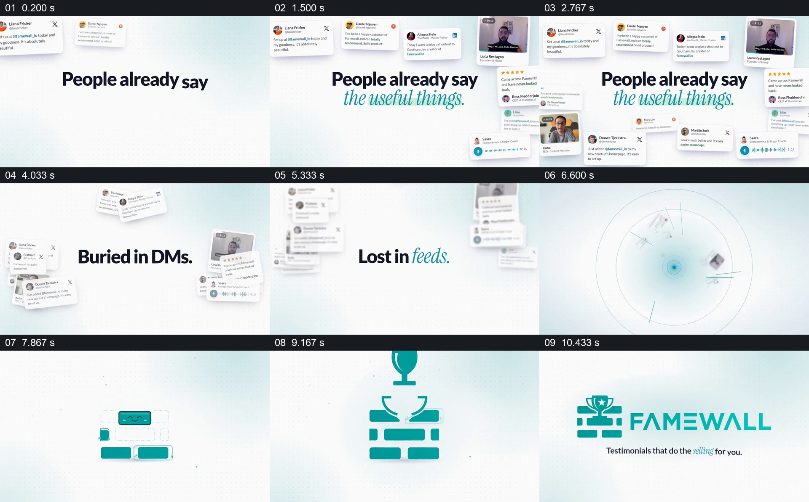

# 先让评价遍布四周，再点出它们被埋没

- 作品：案例 009《人物评价与内容墙》（索引名称）。
- 原片范围：00:00.000–00:11.500，含起点、不含终点；[完整原片](../video.mp4)｜[本卡片段](c01.mp4)。
- 观察方式：依据整片 64 宫格和约每秒一次的真实源帧观察，未连续原速观看或听审；声音、语气与完整播放节奏未确认。

## 原画面具体怎样设计

浅色背景中央出现“People already say the useful things.”，四周逐渐聚集带头像、文字、星级和视频画面的反馈卡。中央文字改为“Buried in DMs.”和“Lost in feeds.”，卡片退到四周，中心留下问题。接着小青色角色与砖块形状出现，组成 FAMEWALL 标识，底部砖块向上排列。

## 为什么这样设计，好在哪里

先看见各式反馈，再看到“埋没”的判断，使问题依托于具体材料，而不只是一个空泛口号。原材料被移到外围、中央留给短句，既保留分散感，也给问题足够的阅读位置；品牌符号承接这些材料，建立产品引入。

以上为依据画面的分析，非作者自述；预期观看效果未经观众测试。

## 可直接使用的创意指令

当要说明已有内容散落在多个渠道且难以被集中查看时，选取能合法展示、来源明确的几种代表性材料，让它们先围绕一句简短的共同观察建立，再把它们移向画面边缘，给具体问题留出中心。用一个与产品相关的形状或物件接住视觉焦点，引入接下来的处理流程。实际材料须有授权；展示数量和界面卡片不代表经过统计的规模。
