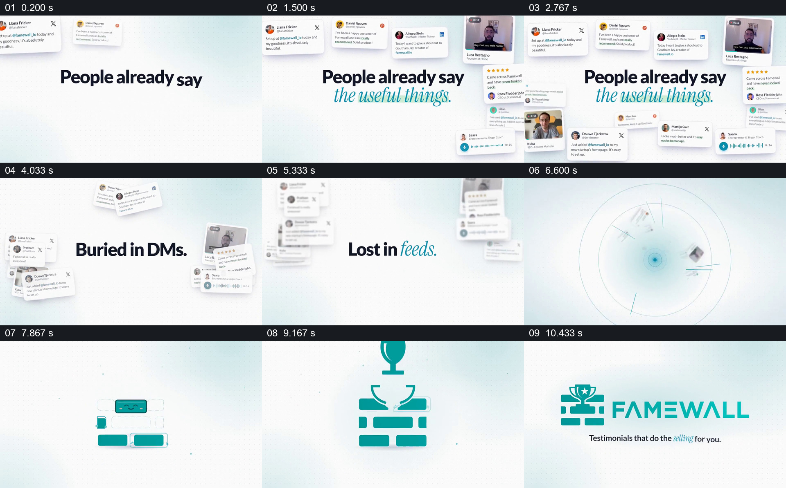

# 评价散落四周，再把分散的内容收进产品标识

- 作品：案例 009，原片中的 FAMEWALL 产品展示。
- 原片范围：00:00.000–00:11.500（源时间，起点包含、终点不包含）；[完整原片](../video.mp4)｜[本卡片段](c01.mp4)。
- 观察方式与未确认范围：查看原片 64 帧总览和本卡九宫格；未独立连续原速观看及听审，抽帧之间的动作衔接、速度、停留和声音配合待复核。评价、数据与界面按片中演示记录，未核实真实性；迁移尚未实测。

## 原画面具体怎样设计

浅色点阵底中，中央先出现黑色“People already say”，青色斜体补出“the useful things.”。不同大小的评价卡分布在画面边缘：有文字、头像、平台标记，也有带人物画面或波形的卡；中央句子保有阅读空间，评价不是一开始就被压成难辨的一团。

接着中央文字依次变为“Buried in DMs.”与“Lost in feeds.”，先前的评价卡移至周围并出现堆叠、模糊等状态。那些原来能阅读的卡片此时仍可辨认是评价，但不再每条占据清楚位置。约 00:06.6，卡片落入由同心线构成的圆形区域，画面中心留下青色小角色；之后角色与青色条块被安排成墙状图形，上方奖杯加入，旁边显示 FAMEWALL 标识与一句简短说明。本卡到约 11.5 秒，下一段进入具体的收集方式。

## 为什么这样设计，好在哪里

这段的视觉问题不是“缺少评价”，而是“评价已经存在，却分散在不同地方”。同一类评价先在句子四周呈现为可辨的内容，再被堆到外围并变得难读，中心文字因此从陈述转为问题；如果一开始只显示一个品牌标识，观众不知道这些文字、人物和音频卡为何需要被组织。

收拢后，青色小角色和墙形条块成为新的注意力中心，随后由墙和奖杯组合为品牌身份。视觉上的收集与排列为产品名称提供了来处，而不是凭空插入标版。以上是依据作品画面作出的分析；卡中姓名、评价及品牌主张的真实性没有独立核实。

## 完整照排指令

以[完整原片](../video.mp4)的 0–11.5 秒为准。画幅 1280×720，源帧率 30/1。以下拍点为抽帧定位，位置按画幅百分比取近似值。

### 用料

- 【评价卡组】备多来源的短评、音频片段或视频预览，各保留头像、发言人或出处标识。若需要展示真实评价，提供可打开的原帖或授权原件及引用位置；内容被重排时保留原意，不伪造用户评价。
- 【中心首句】【中心次句】【分散短句甲】【分散短句乙】【品牌字】【品牌副句】【邻段标题】【邻段表单】均用画位可容纳的短文。备有可分解的【产品标识】，中心图形与砖块结构需能分别入场。若标识形状不同，保留外围评价收拢到中心，再由几块拼成完整标记的过程。

### 按源时刻摆放

1. **0.000–约 3.000 秒。** 白与极淡青渐变铺满，中心先用紧凑黑粗【中心首句】，第二行浅青斜衬线【中心次句】。外围的【评价卡组】从顶部向两边和下部累积，保留宽白边和细灰阴影。文字评价用密小灰黑字，视频位留画面缩略图，声音评价留短条。外围疏密有区别，中间标题保持独占。若使用动态预览，从各自到位播至卡缩退，勿用冻结发言画面暗示已播放音频；静态引用卡按截图处理。
2. **约 3.000–6.000 秒。** 中央黑粗【分散短句甲】替换前句，评价仍在左右夹住中心；随后转成【分散短句乙】，末词斜体青色。卡片层绕向外部并向发亮的淡青中心缩小，轨迹用细浅弧线衔接，原卡尺寸逐步收窄。不能在换中心字时提早清空周边。约 6 秒用青色块接管中心，结束评价窗。
3. **约 6.000–9.000 秒。** 背景保持浅青白。青色小砖先零散出现，随后三行错缝靠拢，中上再加入图标主体与轻薄圆线，拼成【产品标识】。字标可读后以粗青【品牌字】与图标横向成组，下方小黑【品牌副句】居中。砖在品牌段末迅速增殖覆盖整幅，随后作为遮板移交下一幕。
4. **约 9.000–11.500 秒。** 左侧出现两行【邻段标题】，黑粗头句及青斜体次句，右半下侧加入白色【邻段表单】，末拍右部逐渐出现额外分享预览卡。按 11.500 秒切出。若只采用收拢与品牌，结束在满幅青砖遮板中。

### 局部采用

有可追溯评价但没有成套标识拆件时，可用 0–约 6 秒，从外围铺开至缩向中心。仅有标识时，可用约 6–9 秒的拼装与遮挡，新的前段须独立交代为何聚拢。

### 验证状态

已对照逐秒原片画序并读回，核对外围逐渐填满、中心换句期间评价持续、卡片缩退后才组标识，以及砖纹遮挡切出。精确切帧、窗内细节、原速听看与换料待核。
