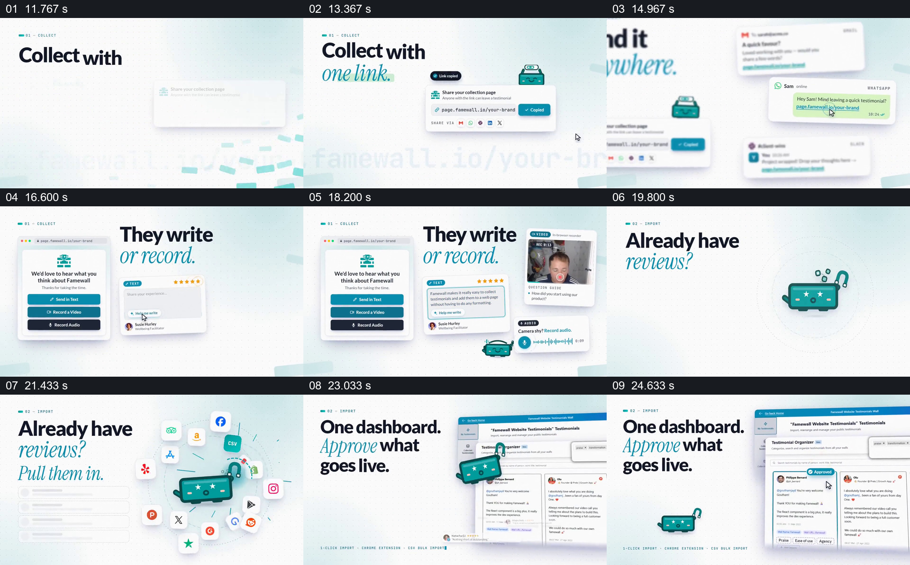

# 一条收集链接串起邀请、回复与审核

- 作品：案例 009《人物评价与内容墙》（索引名称）。
- 原片范围：00:11.500–00:26.000，含起点、不含终点；[完整原片](../video.mp4)｜[本卡片段](c02.mp4)。
- 观察方式：依据整片 64 宫格和约每秒一次的真实源帧观察，未连续原速观看或听审；声音、语气与完整播放节奏未确认。

## 原画面具体怎样设计

标题先写“Collect with one link.”，右侧出现分享链接的小界面；随后“Send it anywhere.”旁并列邮件和消息样式。下一画面把“ They write or record.”放在页面与视频、文字和音频反馈旁。接着各平台图标围绕青色角色出现，文字说已有评价可以导入；最后出现“One dashboard. Approve what goes live.”，右侧展示多条评价和审核界面。

## 为什么这样设计，好在哪里

片中用共同的浅色版面和一个反复出现的小角色连接不同输入形式，让观众看到资料从邀请、回应到审核的连续去向。每一步同时给出短句与对应界面，能把抽象功能放回操作位置；显示界面不等于功能或自动化程度已获验证。

以上为依据画面的分析，非作者自述；预期观看效果未经观众测试。

## 可直接使用的创意指令

当内容需要交代如何从多个来源获得材料并决定哪些内容公开时，依实际流程准备分享入口、接收者可能提交的格式、已有资料的导入方式和审核位置。用同一布局逐步展示请求、回应与集中处理；每次保留足够大的界面局部，使动作与结果能对上。多条输入路径可分开标注，涉及真实功能、授权或隐私时，以经过核实的产品能力和材料权限为准。
