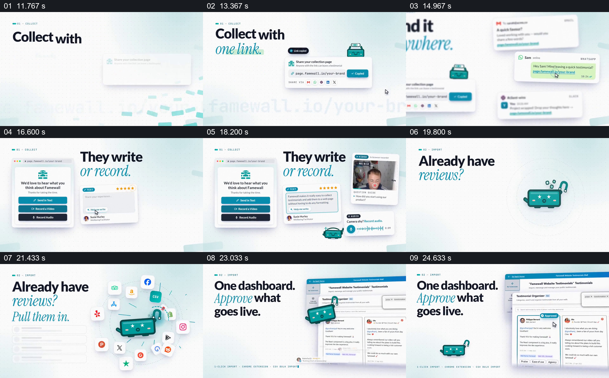

# 一条链接分发出去，多种回复汇入同一待审空间

- 作品：案例 009，原片中的 FAMEWALL 产品展示。
- 原片范围：00:11.500–00:26.000（源时间，起点包含、终点不包含）；[完整原片](../video.mp4)｜[本卡片段](c02.mp4)。
- 观察方式与未确认范围：查看原片 64 帧总览和本卡九宫格；未独立连续原速观看及听审，抽帧之间的动作衔接、速度、停留和声音配合待复核。评价、数据与界面按片中演示记录，未核实真实性；迁移尚未实测。

## 原画面具体怎样设计

约 00:11.5，浅底左侧出现“Collect with one link.”，右侧是一张写有收集页面地址和复制按钮的卡，青色角色位于其上。地址被标示为已复制；接下来卡片让位，多张邮件、消息界面浮在右侧，均承载同一类收集请求。左侧短句换成“Send it anywhere.”，注意力从一个可复制入口移到不同发送场景。

约 00:16，左侧出现收集页面，列出文字、视频和音频入口；右侧先是文字评价框，再并置视频人物窗口和音频波形。一个页面与几种不同形态的回复同时可见，回应前一段发出的请求。约 00:19.8，标题转为“Already have reviews?”，青色角色变成带磁铁的形象，周围排列多种平台图标和 CSV；随后右侧出现评价管理界面，左侧文字指向“一个面板”和“决定哪些内容上线”，其中一张评价显示批准状态。本段至约 26 秒交给下一个展示场景。

## 为什么这样设计，好在哪里

链接卡、发送界面、回复形式和审核面板依次回答不同问题：从哪里发出、可以到哪里、对方可以如何回复、收回后放在哪里。每一阶段保留具体的界面或内容作为参照；多种渠道与多种回复并列时，没有把它们都压成一个抽象图标。

后半段不是继续重复发链接，而是给已有评价另一条进入路径：平台标记围绕磁铁角色，再由管理面板接管，最后落到单条评价的批准状态。两条收集路径在同一整理目标下汇合，因此可以作为一个完整的收集与接收单元。画面是产品演示，不能单凭这些图标认定平台接入或授权真实存在。

## 可直接使用的创意指令

当新流程确实有一个可共享的入口和多个接收渠道，先明确展示可辨认的入口及一次真实操作，再让同一入口出现在与目标用户有关的若干渠道中。每个渠道只保留识别用途所需的界面片段；随后把焦点交给收件人真正可以提交的不同内容形式，使请求和回复在逻辑上对应。

若还有既有资料导入路径，单独展示来源及其进入同一处理空间的关系，接着用具体的一项内容展示确认、筛选或下一步，而不是停在“连接成功”。入口样式、渠道数量、角色与图形可替换，保持“发出—产生可识别回复／导入—汇入明确处理位置”的关系。没有真实接口、授权或回复素材时，标明为演示；不把图标数量等同于已经支持的服务数量。
