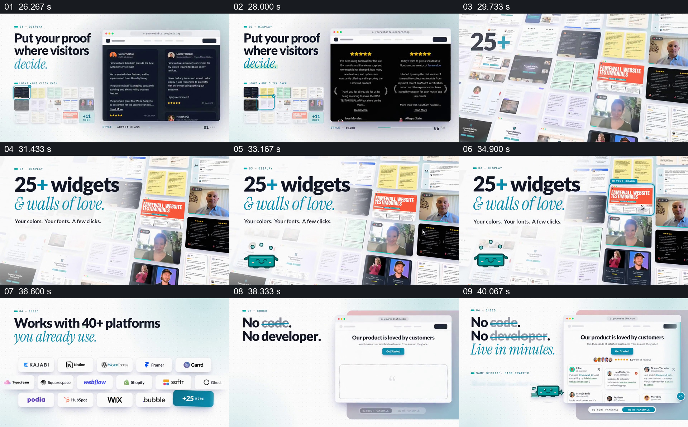

# 把同一批反馈放进不同页面，展示形式和部署位置

- 作品：案例 009《人物评价与内容墙》（索引名称）。
- 原片范围：00:26.000–00:41.500，含起点、不含终点；[完整原片](../video.mp4)｜[本卡片段](c03.mp4)。
- 观察方式：依据整片 64 宫格和约每秒一次的真实源帧观察，未连续原速观看或听审；声音、语气与完整播放节奏未确认。

## 原画面具体怎样设计

左侧出现“Put your proof where visitors decide.”，右侧网页中的评价区域先后变成黄色、黑色和浅色样式，旁边保留配色选择。随后“25+ widgets & walls of love.”与一列不同页面和人物视频示例同屏；平台标识集合出现，最后是“No code. No developer. Live in minutes.”及带评价模块的网页。

## 为什么这样设计，好在哪里

先在一个页面位置看到样式变化，再看到多种示例和平台，观众可以把“可配置”与实际呈现连接起来，而不是只读功能名称。平台数量和易用性是片中宣传，素材墙与示意界面本身不能证明这些主张。

以上为依据画面的分析，非作者自述；预期观看效果未经观众测试。

## 可直接使用的创意指令

当需要说明内容可用于多个位置而样式可变化时，选择一条有代表性的内容，先放进一个可辨的页面位置，保持位置和内容关系不变，依次展示少量确有差异的外观；再用整组示例说明覆盖面，最后回到一个具体发布结果。平台、数量和操作门槛应来自核实资料；长评价单独放大或留足阅读时间，不能依赖缩小的缩略图。
