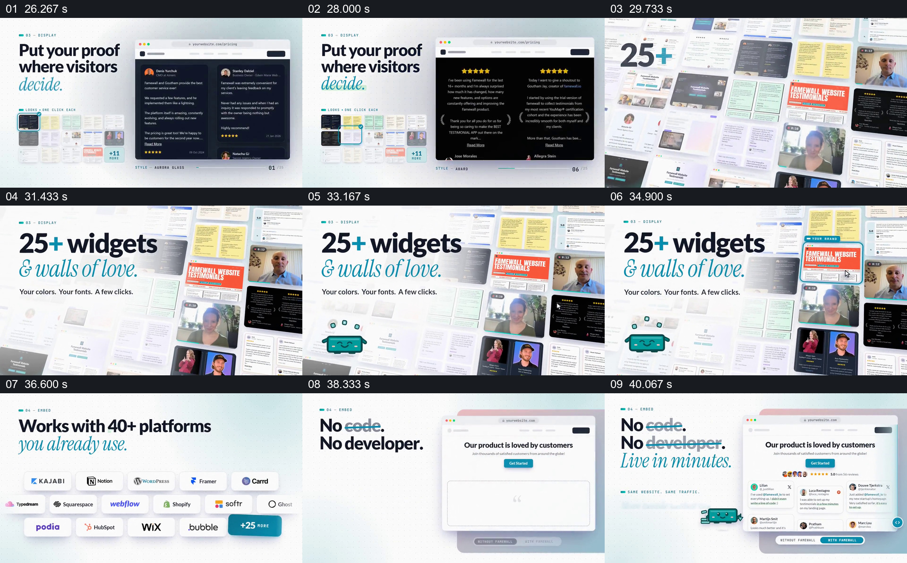

# 让同一类评价在不同页面样式中展示，再回到使用前后

- 作品：案例 009，原片中的 FAMEWALL 产品展示。
- 原片范围：00:26.000–00:41.500（源时间，起点包含、终点不包含）；[完整原片](../video.mp4)｜[本卡片段](c03.mp4)。
- 观察方式与未确认范围：查看原片 64 帧总览和本卡九宫格；未独立连续原速观看及听审，抽帧之间的动作衔接、速度、停留和声音配合待复核。评价、数据与界面按片中演示记录，未核实真实性；迁移尚未实测。

## 原画面具体怎样设计

约 00:26，左侧是“Put your proof where visitors decide.”，下方排着多张小样式缩略图；右侧是一张更大的网页窗口，内部有深色评价区、头像、星级和文字。缩略图上的高亮边框位置改变时，右侧大窗口显示另一种排版，顶部页面外框保持相似。观众可同时看到选择入口和放大后的效果。

约 00:29.7，网页让位于铺满背景的多种评价组件：浅色、深色、文字、人物视频等内容倾斜排布。左侧“25+ widgets & walls of love.”及较小文字出现在集合之前，部分卡片清晰，远处卡片减弱；青色角色在前景出现。约 00:36，集合退出，页面列出若干平台名称。

约 00:38，右侧出现网页窗口，页面标题和按钮下方有空白的评价区域；下方“WITHOUT FAMEWALL / WITH FAMEWALL”指示两种状态。之后同一页面的区域出现头像、星级和多张评价卡，青色角色靠近下方。左侧以“No code. No developer. Live in minutes.”组织该画面的说明；本段结束后进入规模和单条证言的展示。

## 为什么这样设计，好在哪里

这段先将一个样式选项和一个足够大的结果窗口放在同一视野，缩略图负责“可选择”，大窗口负责“实际长什么样”。再从单个结果扩展到铺满背景的多种版本，使“有多种排法”成为可见的集合，而不只是一行数量。

最后回到同一网页的空白和填充状态，主体页面结构相同，改变的是评价区域，观众因此能把前后的差异对应到被展示的内容。若前后换成两个完全不同的网站，就难以看出比较对象。平台数量、无需开发与上线时间都是片中宣传语，不视为已经核实的功能或性能。

## 完整照排指令

以[完整原片](../video.mp4)的 26–41.5 秒为准。画幅 1280×720，源帧率 30/1。以下拍点为抽帧定位，位置按画幅百分比取近似值。

### 用料

- 【评价内容组】取有授权的短评与视频封面，附可核对出处。备【展示样式组】，在同一类评价上验证暗双栏、浅色双栏和视频卡等实际样式。再备【嵌入前页面】【嵌入后页面】，须是同一网页、同一位置和裁切，区别落实在新增评价区。
- 【展示主句】【展示强调】【样式总数】【样式单位】【样式补句】【平台主句】【平台数量】【平台标识组】【嵌入主句】【嵌入补句】【状态标签】【末段读数】换成可核对的项。统计数附对应目录或记录与日期，平台兼容以实际支持为准。【引导角色】沿用前卡图形。

### 按源时刻摆放

1. **26.000–约 29.500 秒。** 浅白青背景。左边 x5% 起排黑粗【展示主句】和青斜【展示强调】，下有小色块预览。右边的大横网页使用白顶栏及软阴影，保持同视点。网页内从低亮黑双栏变到黄、青、白或淡紫双栏，再到暗板视频评价与暖橙标题页。每次仅更换【展示样式组】对应内容区，左边文案与浏览器壳保持。声音和人物动作若用于版式说明可用静态预览。
2. **约 29.500–35.000 秒。** 用斜向样式墙接管右侧，放大多个【展示样式组】的卡面并越过顶、右和底边。左面保留浅色空区，黑青粗【样式总数】【样式单位】，下面青斜【样式补句】及小一档解释。左下出现【引导角色】。各样式只作可识别缩图时允许静态缓移，不逐张替换整个样式墙。
3. **约 35.000–37.500 秒。** 样式墙整体离场。左上黑粗【平台主句】，其中【平台数量】与主句同级，下一行青斜副句。下半分数排放【平台标识组】，每个嵌白色小圆角槽，可用较窄的青色尾签表示其余平台。排序需保留读得清的合作平台。
4. **约 37.500–40.500 秒。** 左上以黑粗【嵌入主句】先出两行，再添一行青斜【嵌入补句】。右侧用【嵌入前页面】保持上沿浅暖顶条、白底与中间空区，底下放小【状态标签】。随后在相同 x、y 和窗口尺寸切换【嵌入后页面】，内容由空位变至多栏评价卡，外壳和顶部原有对象仍可追踪。左右文作为伴随层，【引导角色】短留左下。两状态可用固定截图，通过同位置切换读清，不必造假滑块。
5. **约 40.500–41.500 秒。** 青砖擦过接向浅底头像阵列，中央深字【末段读数】逐次建立。按 41.500 秒切出。独立采用嵌入比较时，结束于砖遮板前或遮板中。

### 局部采用

有同类内容的多版式可取约 26–35 秒。只有网页前后图可独立取约 37.500–40.500 秒，保留同一网页的同位变化。

### 验证状态

已对照每秒两帧原片画序并读回，核对同一浏览器壳切样式、斜墙与标题留白、同一网页位置的前后图，以及砖墙切出。切点和反复换版的精确帧、原速听看和换料待核。
