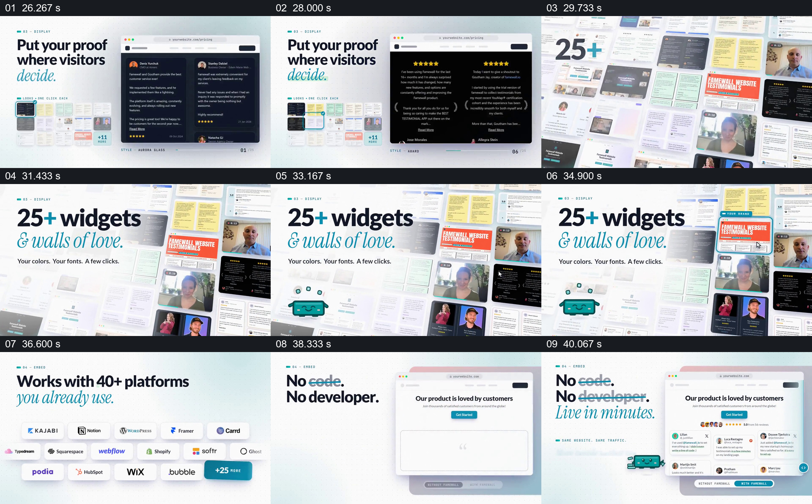

# 让同一类评价在不同页面样式中展示，再回到使用前后

- 作品：案例 009，原片中的 FAMEWALL 产品展示。
- 原片范围：00:26.000–00:41.500（源时间，起点包含、终点不包含）；[完整原片](../video.mp4)｜[本卡片段](c03.mp4)。
- 观察方式与未确认范围：查看原片 64 帧总览和本卡九宫格；未独立连续原速观看及听审，抽帧之间的动作衔接、速度、停留和声音配合待复核。评价、数据与界面按片中演示记录，未核实真实性；迁移尚未实测。

## 原画面具体怎样设计

约 00:26，左侧是“Put your proof where visitors decide.”，下方排着多张小样式缩略图；右侧是一张更大的网页窗口，内部有深色评价区、头像、星级和文字。缩略图上的高亮边框位置改变时，右侧大窗口显示另一种排版，顶部页面外框保持相似。观众可同时看到选择入口和放大后的效果。

约 00:29.7，网页让位于铺满背景的多种评价组件：浅色、深色、文字、人物视频等内容倾斜排布。左侧“25+ widgets & walls of love.”及较小文字出现在集合之前，部分卡片清晰，远处卡片减弱；青色角色在前景出现。约 00:36，集合退出，页面列出若干平台名称。

约 00:38，右侧出现网页窗口，页面标题和按钮下方有空白的评价区域；下方“WITHOUT FAMEWALL / WITH FAMEWALL”指示两种状态。之后同一页面的区域出现头像、星级和多张评价卡，青色角色靠近下方。左侧以“No code. No developer. Live in minutes.”组织该画面的说明；本段结束后进入规模和单条证言的展示。

## 为什么这样设计，好在哪里

这段先将一个样式选项和一个足够大的结果窗口放在同一视野，缩略图负责“可选择”，大窗口负责“实际长什么样”。再从单个结果扩展到铺满背景的多种版本，使“有多种排法”成为可见的集合，而不只是一行数量。

最后回到同一网页的空白和填充状态，主体页面结构相同，改变的是评价区域，观众因此能把前后的差异对应到被展示的内容。若前后换成两个完全不同的网站，就难以看出比较对象。平台数量、无需开发与上线时间都是片中宣传语，不视为已经核实的功能或性能。

## 可直接使用的创意指令

当同一批内容需要在多种载体或版式里展示，先挑选少量真实可用的样式，保留一个清楚的选择区及一个足以阅读内容的大预览；改变选项时保留内容的身份或用途，让观众知道改变的是呈现方式。然后可把若干结果扩成集合，通过清晰与弱化的主次，展示选择的范围。

若需要说明应用前后的差异，选用同一个页面或同一真实场景，尽可能保持标题、主体和环境一致，只改变与表达目标有关的区域；前后状态应有真实依据或标作模拟。结束时留下可读的结果，再接后续结论。缩略图形状、网页皮肤、数量与背景可调整，必要关系是“具体选择对应可观察结果”以及“对照时保持其他条件可辨”。需要深入阅读评价时减少同时出现的卡片并延长停留。
