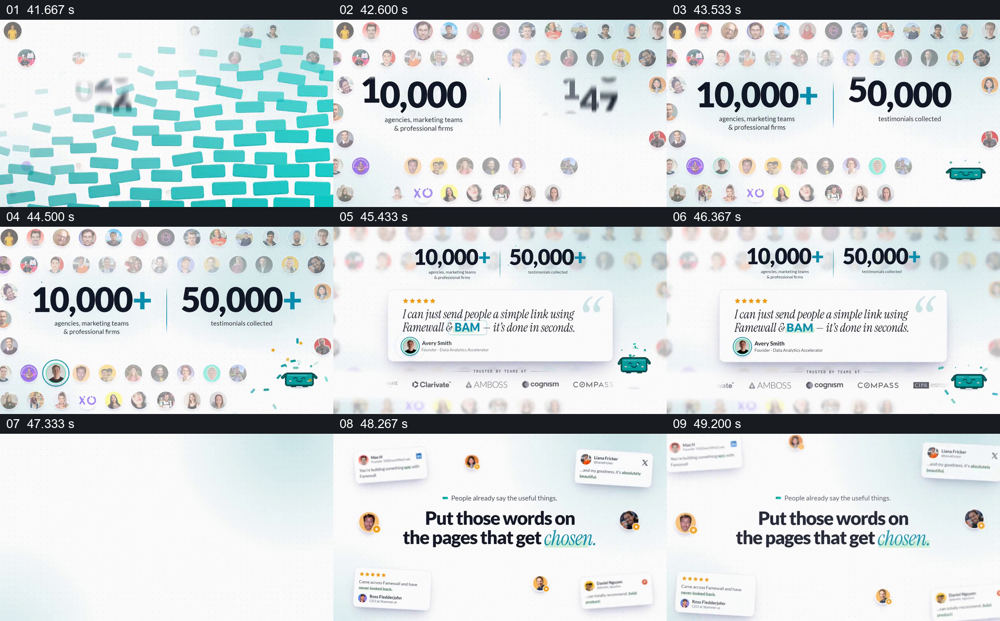

# 先看群体规模，再从头像中挑出一条完整证言

- 作品：案例 009，原片中的 FAMEWALL 产品展示。
- 原片范围：00:41.500–00:50.000（源时间，起点包含、终点不包含）；[完整原片](../video.mp4)｜[本卡片段](c04.mp4)。
- 观察方式与未确认范围：查看原片 64 帧总览和本卡九宫格；未独立连续原速观看及听审，抽帧之间的动作衔接、速度、停留和声音配合待复核。评价、数据与界面按片中演示记录，未核实真实性；迁移尚未实测。

## 原画面具体怎样设计

约 00:41.5，青色砖块式画面退开，许多圆形头像出现在浅色背景上下方；中央两组大数字逐步形成“10,000+”与“50,000+”，下方分别标示机构或团队、已收集评价等说明，青色加号成为数字中的强调。此时头像形成围绕中央统计的边界，不同头像仍保有独立的圆形轮廓。

约 00:44.5，靠下的一枚头像被圆环突出，后续头像群变软、退到背景，原有两项总数缩小并留在上方。一张白色长评价卡在中间取得更大面积，包含星级、引语、人物头像与署名；下方还有一排机构名称标记。随后评价让位，回到评价卡散布在四周、中央显示“Put those words on the pages that get chosen.”的构图，呼应原片开场的评价主题。

## 为什么这样设计，好在哪里

群体头像为大数字提供视觉来源，大数字又让观众先理解片中想表达的总体规模；突出其中一个头像之后，同一组素材从统计的背景变成单条证言的出处。上方数字并未立刻消失，因此从整体转到具体时仍保留总体参照。

若只有增长数字，观众不知道评价具体是什么；若只有单条引语，也看不到原片随后声称的规模。二者先后接力，并由相同的头像形式连接。图中统计、人物、署名和标志均为作品内呈现，未经独立核验，不代表真实客户或效果。

## 可直接使用的创意指令

当需要同时展示有依据的总体结果和代表性个例，先核实统计口径、时间范围与使用授权，准备能够对应群体的真实材料；用头像、项目或评价等相同类型的独立对象形成集合，在不遮挡说明的中央呈现少量关键统计。

从这个集合中选出一项有代表性的材料，给出可辨认的选择线索；让其余对象退为背景，保留必要的总体参照，再放大该项的完整内容、来源与必要语境。最后回到与主题有关的结论或下一步。人数、视觉容器、颜色和品牌元素可改，不能丢失“总体与个例各自有依据、个例来自所述集合、上下文可理解”的关系；若缺少可核实数据，就仅展示明确标注的案例，不制造规模感。
