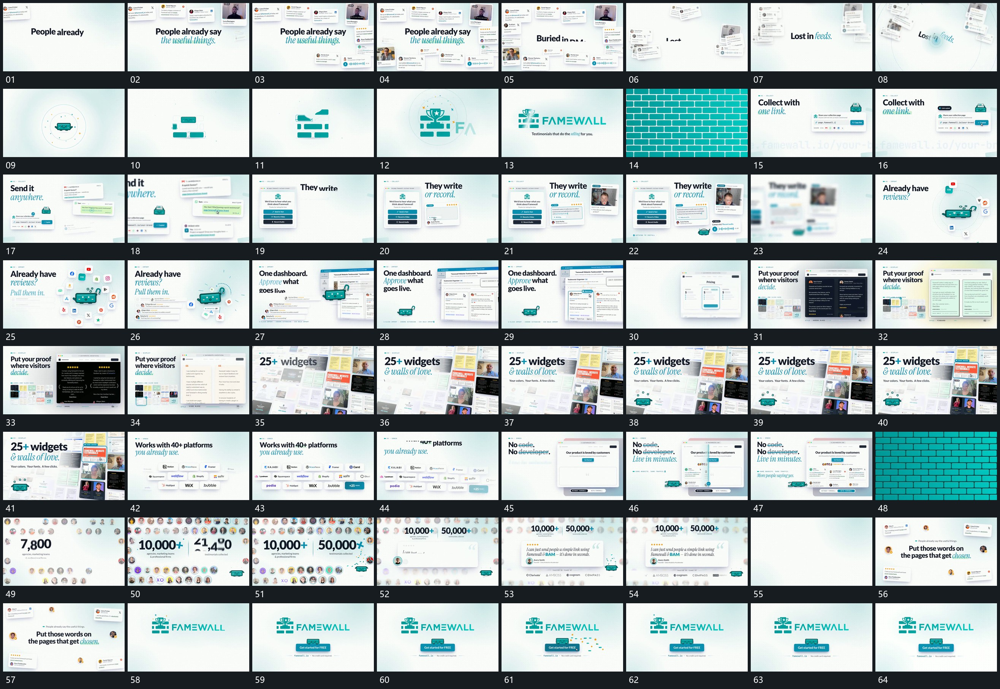

# 009｜原片运动总览

[观看完整原片](video.mp4)

## 运动总览

开头 外围卡片错开补齐，中心文字保留后集合散开 将外围卡片逐项补齐，中心文字建立后让集合散开。小块分别落入固定槽，组合成中心结构 让小块归入固定空位并组合成中心结构，再由 重复块铺满画面，借覆盖揭出新布局 把重复结构铺成满幅，借覆盖换入下一组。

中段先建立并置小框，主框保持，旁侧内容片依次接入 保留主框、从旁侧逐项补入内容片。外围标记绕中心进入，再收拢退去 使外围小标记绕中心进入，再收拢退去，中心留场。接着进入多处大框，固定外框内轮换排布，拉远后展示集合 在同一边界内轮换不同内部排布；再拉远为满幅集合，前方标题和小形保留。

后段多排短条横向经过。数字段 外围圆点逐项亮起，中央数字增长后引用卡接入 将外围小圆逐项亮起，数值增长后停稳；前方引用卡建立时外围退虚，最后回到中心字组与小形。片尾小形附近短片散出，作为完成反馈，不另加重复机制。

## 完整运动段落

以下按原片中的出现顺序引用。建立、内部发展及完成反馈放在同一段中；同时发生的局部动作与运镜写在同一份指令里。不同段之间可以是连续接管，也可以是直接切换，不能仅凭条目相邻认定可直接拼接。重复出现的同类运动采用一次连续代表范围，切片不以逐段无缝覆盖整片为目标。

1. [外围卡片错开补齐，中心文字保留后集合散开](mechanisms/m01.md)：卡片累计时文字保持，散开后主次改变

2. [小块分别落入固定槽，组合成中心结构](mechanisms/m02.md)：已有块固定，后块补入剩余空位

3. [重复块铺满画面，借覆盖揭出新布局](mechanisms/m03.md)：重复块接近铺满时旧层被遮住，下一层再露出

4. [主框保持，旁侧内容片依次接入](mechanisms/m04.md)：从主框旁逐项增加，旧层不移动

5. [外围标记绕中心进入，再收拢退去](mechanisms/m05.md)：外围路径独立，中心作为不动参照

6. [固定外框内轮换排布，拉远后展示集合](mechanisms/m06.md)：换内容保持边界，再改变观察范围

7. [外围圆点逐项亮起，中央数字增长后引用卡接入](mechanisms/m07.md)：点阵与数值推进，前卡在结果后接管

切片保留起始准备、必要内部停顿和完成或明确交接；首尾省略无新发展的等待，持续运动不要求人为停住。以上基于真实源帧序列和重点边界核对，不等同于全片连续声画审片。

## 完整64宫格

