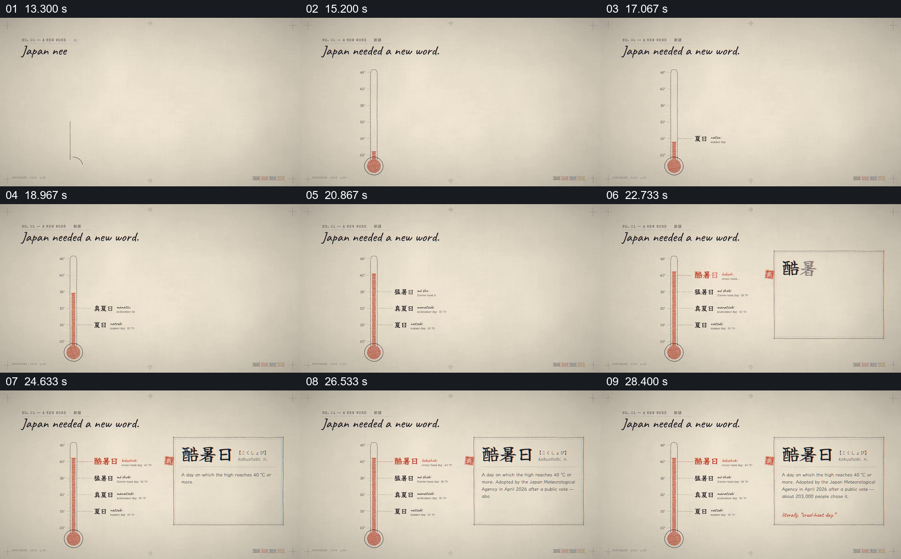

# 让温度计长出等级，再把新词展开成词条

- 作品：案例 052，夏季气象数据可视化（库内案例）。
- 原片范围：13.000–30.000 秒；[完整原片](../video.mp4)｜[本卡片段](c01.mp4)。含起点、不含终点。
- 观察方式：核看全片 64 格和本卡九宫格；未独立连续原速观看或听审，精确运动、节奏、声音及声画关系未知。片中数据未独立核验，迁移尚未实测。

## 原画面具体怎样设计

米色纸张背景左上写“Japan needed a new word.”，中央偏左先画出细长温度计和刻度。红色液柱在不同时刻到达更高位置，右边依次标出夏日、真夏日、猛暑日及最高位置的“酷暑日”；最高一项使用红字和红线，与下方其他等级区分。

温度计保留在左侧时，右边出现带细边框的大型词条卡：标题是“酷暑日”及读音，下方逐步出现达到 40°C 的定义、采用时间与说明；旁边有红色印章。最终左边保留数值与等级阶梯，右边提供完整定义，两者同时可见。

## 为什么这样设计，好在哪里

温度计先建立观众熟悉的连续刻度，再把每个名称系到对应位置，新词不是单独从空白里出现。最高档用颜色强调，但下面各档仍在，因此观众可比较它与原先等级的关系。右侧展开的词条把简短标签转成完整、可阅读的定义，而不遮掉作为参照的刻度。

这里的名称、阈值和采用时间均是原片呈现，未经本卡独立事实核实；液柱速度和文字出现的精确节奏不能仅凭九帧确认。

## 可直接使用的创意指令

适用于确有连续数值、分档标准和新增类别的内容。先选择真实量纲和刻度，以一个持续可见的测量对象建立范围，再将已有等级标在准确位置；突出新的阈值时保留下方各档作为参照。随后在不遮住刻度的区域展开该类别的定义和必要限定，形成数字位置与文字解释的对应。

温度计、纸张、印章和色彩均可替换；保持的是准确阈值、前后等级关系及可读定义。分类依据和来源必须核实，不能仅凭排版暗示新等级已被正式采用。
